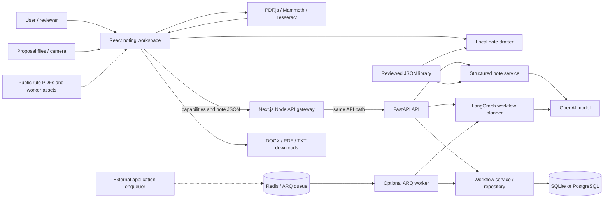
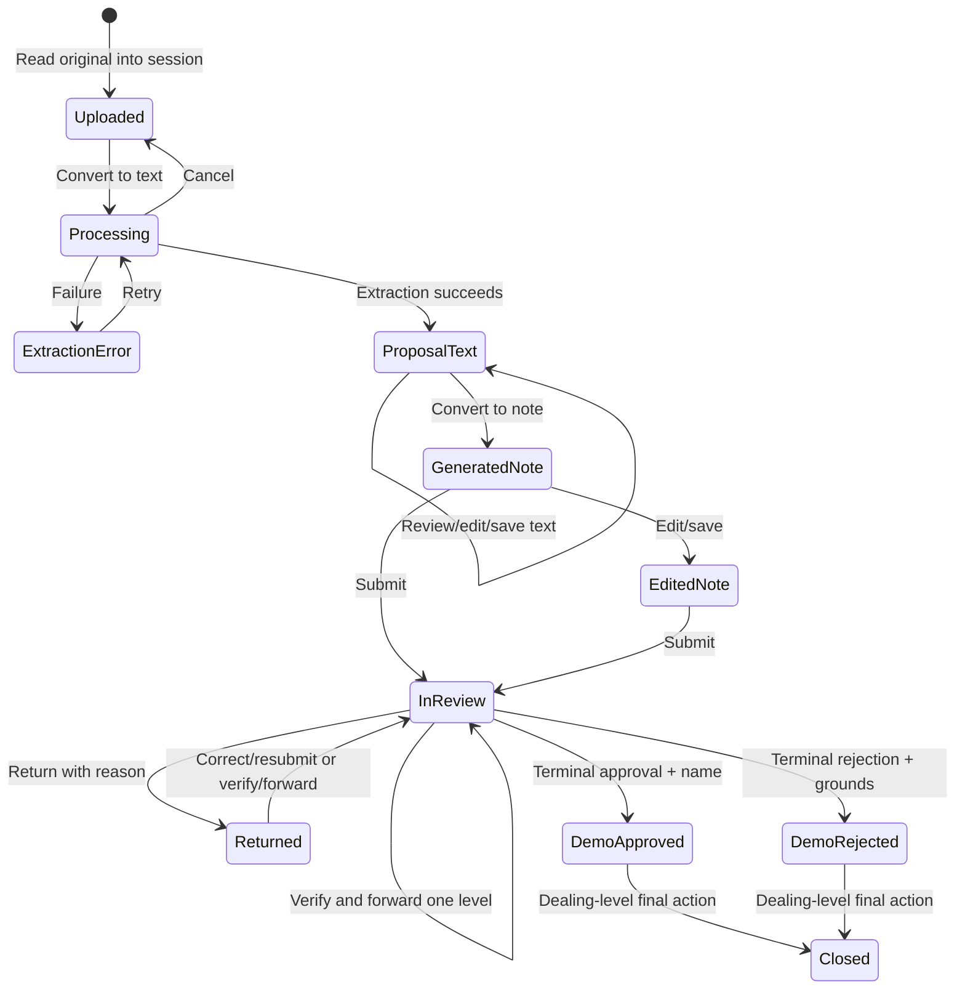
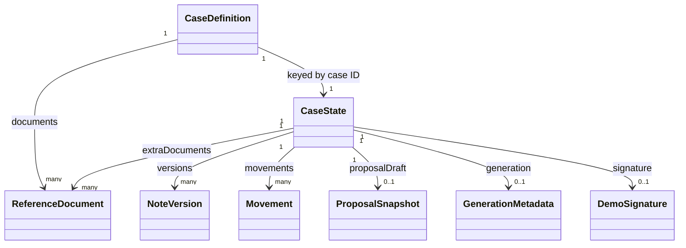
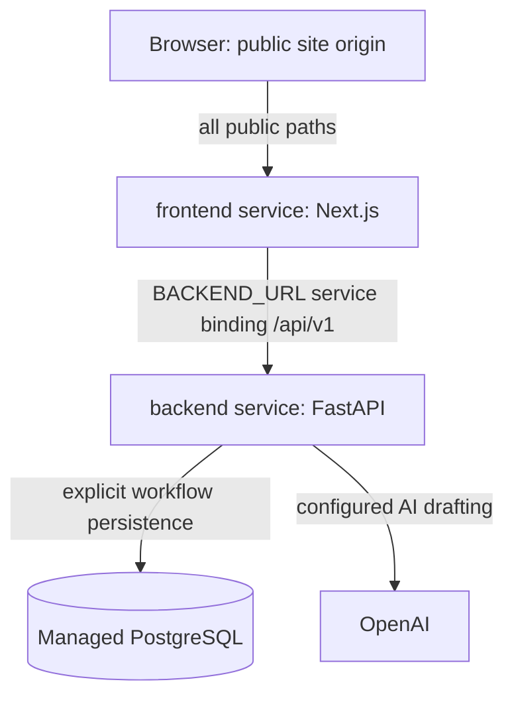

# InstinctGo — Full System Architecture

- **Document location:** `docs/architecture.md`
- **Absolute location in this checkout:** `D:\instinctgo\docs\architecture.md`
- **Reviewed:** 7 November 2026
- **Application version:** `0.1.0`
- **Source baseline:** `c756110fa3394b3381a2d54ca1bf2ed06eda3a2b`

This document describes the implementation in this repository: its runtime systems,
processing algorithms, interfaces, data structures, operational configuration, and
build/deployment process. Paths are relative to the repository root unless stated
otherwise. Diagrams use Mermaid, supported by GitHub and many Markdown viewers.

## Contents

1. [System purpose and implementation map](#1-system-purpose-and-implementation-map)
2. [System topology and boundaries](#2-system-topology-and-boundaries)
3. [Repository and dependency structure](#3-repository-and-dependency-structure)
4. [Frontend application and user interface](#4-frontend-application-and-user-interface)
5. [Document intake, scanning, extraction, and OCR](#5-document-intake-scanning-extraction-and-ocr)
6. [Finance note generation](#6-finance-note-generation)
7. [Rule library and source provenance](#7-rule-library-and-source-provenance)
8. [Review workflow and decision state machine](#8-review-workflow-and-decision-state-machine)
9. [Assistant and reference search](#9-assistant-and-reference-search)
10. [Editing, preview, and document export](#10-editing-preview-and-document-export)
11. [Backend application and request gateway](#11-backend-application-and-request-gateway)
12. [Complete HTTP API contracts](#12-complete-http-api-contracts)
13. [Generic workflow planning](#13-generic-workflow-planning)
14. [Persistence and data models](#14-persistence-and-data-models)
15. [Background jobs and integration extension points](#15-background-jobs-and-integration-extension-points)
16. [Configuration and environment variables](#16-configuration-and-environment-variables)
17. [Build, local operation, and deployment](#17-build-local-operation-and-deployment)
18. [Data handling and application access](#18-data-handling-and-application-access)
19. [Reliability, performance, and observability](#19-reliability-performance-and-observability)
20. [Verification and troubleshooting](#20-verification-and-troubleshooting)
21. [Implementation boundaries and extension guide](#21-implementation-boundaries-and-extension-guide)
22. [Source-file navigation index](#22-source-file-navigation-index)

## 1. System purpose and implementation map

InstinctGo converts documents and manually described processes into structured drafts.
The repository currently contains two connected-to-the-same-backend product flows:

1. **Finance noting workspace:** a browser application for importing a proposal,
   extracting and reviewing its text, generating an examination note, consulting
   supplied rules, editing/exporting the result, and demonstrating sequential review.
2. **Generic workflow API:** a FastAPI service that generates structured workflow
   plans from process descriptions and stores explicitly saved plans in a database.

The homepage uses the finance noting flow. It calls the noting API when AI is
configured; it does not use the generic workflow planning or persistence endpoints.
Consequently, a note visible in the browser is not a row in the `workflows` table.

### 1.1 Runtime capability map

| System | Implementation | Execution/storage location |
| --- | --- | --- |
| Landing page and workspace | Next.js App Router, React components, CSS, Lenis | Frontend service and browser |
| File intake and camera scanning | FileReader, Blob URLs, MediaDevices, Canvas | Browser |
| PDF/DOCX/text extraction | PDF.js, Mammoth, UTF-8 decoding | Browser |
| Image/scanned-page OCR | Tesseract.js, English model, owned Web Worker | Browser |
| Local note drafting | Category/fact extraction, rule matching, format profiles, arithmetic | Browser |
| AI note drafting | FastAPI + LangChain `ChatOpenAI` structured response | Backend → OpenAI |
| Rule references | Reviewed JSON library and supplied PDF sources | Build inputs, browser assets, backend bundle |
| Rich-text editing and preview | Tiptap/ProseMirror and DOM-based pagination | Browser |
| Word/PDF/TXT exports | `docx`, jsPDF, Blob downloads | Browser → user's downloads |
| Sequential note review | Pure TypeScript guards and session state | Browser memory |
| Assistant chat | Deterministic `demoAI` adapter | Browser |
| API gateway | Next.js Node.js catch-all route | Frontend server → FastAPI |
| Generic workflow planning | One-node LangGraph and structured `WorkflowPlan` | Backend → OpenAI |
| Saved workflow plans | SQLAlchemy async repository and service | SQLite locally / configured PostgreSQL |
| Optional background drafting | ARQ task and Redis connection settings | Separate worker process |
| Python document parser | Callable synchronous extraction helper | Backend/worker when explicitly invoked |
| Offline hero-image preparation | Python image scripts and optional restoration models | Developer tooling |
| 3D preview | Lazy-loaded React Three Fiber cube component | Available component; not mounted on homepage |
| Older administrative demo views | Overview, explorer, administration, sample datasets | Retained components/fixtures; not the active homepage shell |

### 1.2 Terms used in this document

- **Proposal:** original applicant document and its reviewed transcription.
- **Note:** examination text generated from the reviewed proposal.
- **Case:** browser object holding metadata, sources, drafts, and review state.
- **Workflow plan:** separate backend JSON plan made of ordered, typed steps.
- **Rulebook:** supplied source PDF registered in the noting library.
- **Applied rule:** a library provision selected for a particular generated note.
- **Style source:** sample-note PDF pages used to derive writing/layout guidance.
- **Review action:** a browser state transition such as submit, forward, or approve.

## 2. System topology and boundaries

### 2.1 Container and data-flow diagram



The queue path is optional and requires a caller to enqueue work. There is no
enqueue HTTP endpoint or automatic queue submission from the noting workspace.

### 2.2 Responsibility boundaries

| Boundary | Responsibility |
| --- | --- |
| React components | Interaction, display, editor state, progress, confirmations |
| `frontend/src/lib/playground/` | Domain types, document conversion, note formation, reference selection, review guards |
| `frontend/src/lib/server/` | Resolve internal backend URL and forward HTTP requests |
| Backend routes | Request/response contracts and HTTP error mapping |
| Pydantic schemas | Input bounds, structured-output shape, workflow dependency validation |
| Backend services | Note validation and workflow save transactions |
| Repository | SQLAlchemy query construction, add/flush/get/list |
| ORM and DB session | Table definitions, engine lifecycle, session/rollback handling |
| Agent graph and prompts | Generic planning orchestration and model instructions |
| ARQ worker | Optional background draft-and-save execution |
| Source preparation scripts | Reproducible runtime assets and bundled reference files |

### 2.3 End-to-end noting sequence

```mermaid
sequenceDiagram
    actor User
    participant UI as Browser workspace
    participant Extract as Browser extraction/OCR
    participant Local as Local drafter
    participant Gateway as Next.js gateway
    participant API as FastAPI noting
    participant Model as OpenAI

    User->>UI: Select file or capture image
    UI->>UI: Validate, read, create case and Blob URL
    User->>UI: Convert to text
    UI->>Extract: File + cancellation signal
    Extract-->>UI: Text, pages, extraction method
    UI->>UI: Store editable proposal version
    User->>UI: Review/edit text, then Convert to note
    UI->>Local: Build local candidate from reviewed text
    Local-->>UI: Local DraftNote
    UI->>Gateway: GET /api/v1/noting/capabilities
    Gateway->>API: Forward request
    API-->>UI: ai_available
    alt AI configured and request succeeds
        UI->>Gateway: POST /api/v1/noting/draft
        Gateway->>API: Proposal and supporting text JSON
        API->>Model: Prompt + source texts + reviewed library
        Model-->>API: Structured NoteContent
        API->>API: Validate facts, rules, money; clean prose
        API-->>UI: DraftNote with engine=ai
    else AI unavailable, timed out, or client rejects response
        UI->>UI: Use previously built local DraftNote
    end
    UI->>UI: Validate rule applicability; preserve proposal snapshot
    UI->>UI: Render note, table, references, generation metadata
    User->>UI: Edit, review, export, or record demo actions
```

## 3. Repository and dependency structure

### 3.1 Repository layout

```text
instinctgo/
├── package.json / package-lock.json  npm workspace scripts and locked dependencies
├── vercel.json / .vercelignore       multi-service deployment and exclusions
├── start-dev.cmd                     Windows launcher
├── backend/
│   ├── app/
│   │   ├── main.py                   FastAPI entrypoint
│   │   ├── api/v1/endpoints/         health, noting, workflow routes
│   │   ├── agents/                  workflow graph, state, prompts
│   │   ├── core/                    settings and JSON logging
│   │   ├── db/                      metadata and async session lifecycle
│   │   ├── models/                  Workflow ORM model
│   │   ├── repositories/            workflow queries
│   │   ├── schemas/                 note/workflow contracts
│   │   ├── services/                note validation and workflow transactions
│   │   ├── ingestion/parsers/       callable Python document parser
│   │   ├── integrations/            adapter extension package
│   │   ├── tools/                   business-action extension package
│   │   └── workers/                 ARQ task and settings
│   ├── migrations/                  Alembic environment and initial schema
│   ├── scripts/prepare-vercel.py    reference-source packaging
│   ├── resources/noting/            generated backend source bundle
│   ├── data/                        local SQLite runtime data
│   ├── storage/uploads/             reserved local ingestion directory
│   ├── tests/                       noting and deployment tests
│   └── pyproject.toml / uv.lock      Python manifest and dependency lock
├── frontend/
│   ├── src/app/                     homepage, layout, CSS, API gateway
│   ├── src/components/              landing, noting, scrolling, 3D components
│   ├── src/lib/playground/          browser domain and processing code
│   ├── src/lib/server/              backend proxy
│   ├── public/document-ocr.js       owned OCR worker wrapper
│   ├── public/document-workers/    generated dependency workers/models
│   ├── public/samples/case-01/      served sample and rule PDFs
│   ├── public/images/hero/         prepared images and retained source images
│   ├── scripts/                    asset/sample preparation tooling
│   └── tests/                      playground and gateway tests
├── samples/
│   ├── noting-library.json         reviewed format profiles and rule summaries
│   ├── noting-source-manifest.json registered rule-source hashes
│   └── case-01/                     source PDFs, generated sample, case manifest
└── docs/                            architecture and operating documentation
```

Directories such as `frontend/src/features/workflows/`, `src/hooks/`, `src/types/`,
and `src/components/ui/` currently contain placeholders. Active domain types are
in `frontend/src/lib/playground/types.ts` and `note-draft.ts`.

### 3.2 Technology and dependency ownership

| Layer | Declared technology | Purpose |
| --- | --- | --- |
| JavaScript runtime | Node.js `>=22.19.0`, npm `>=10` | Workspace install, frontend build/server, TypeScript scripts |
| Frontend | Next.js `^16.4.3`, React/React DOM `^19.3.1` | App Router page and interactive client application |
| Type/styling tools | TypeScript `^6.0.3`, Tailwind CSS `^4.3.3`, ESLint | Strict type checking, styles, linting |
| Editor | Tiptap `^3.32.2` family | ProseMirror editor, tables, starter formatting |
| Browser extraction | PDF.js `^6.5.438`, Mammoth `^1.13.0` | PDF text/rendering and DOCX raw text |
| OCR | Tesseract.js `^7.0.0`, English data package | Local scanned-page/image recognition |
| Export | `docx` `^9.15.1`, jsPDF `^4.2.1` | Downloadable Word/PDF generation |
| Presentation | Lenis, Lucide, Three.js, React Three Fiber, Drei | Scrolling, icons, optional 3D |
| Python runtime | `.python-version`: Python 3.12 | Selected local/deployment interpreter |
| Backend | FastAPI, Pydantic, pydantic-settings, Uvicorn | ASGI API and environment-based settings |
| AI | LangChain OpenAI, LangGraph | Structured model responses and workflow graph |
| Persistence | SQLAlchemy asyncio, Alembic, aiosqlite, asyncpg | ORM, migrations, SQLite/PostgreSQL drivers |
| Background | ARQ, Redis | Optional asynchronous job processing |
| Python documents | pypdf, python-docx | Callable local-file parser |
| Backend tooling | structlog, HTTPX, pytest, pytest-asyncio, Ruff | Logs, API testing, lint/format checks |

These are manifest declarations rather than a claim about globally installed versions.
`package-lock.json` and `backend/uv.lock` pin dependency resolution. Python package
metadata permits `>=3.11`; the checked-in interpreter selection is 3.12, and Ruff
targets Python 3.11 syntax compatibility. The root npm workspace contains `frontend`;
Python dependencies are managed independently with uv.

## 4. Frontend application and user interface

### 4.1 Page composition

`frontend/src/app/page.tsx` renders a single homepage containing:

- A layered parallax hero and navigation anchors.
- Introductory product content.
- `AdministrativePlayground` mounted at `#workspace`.
- Product-flow sections and footer.

`layout.tsx` provides metadata, the English document language, Poppins and Playfair
Display through `next/font/google`, local Barlow Condensed, global CSS, and the
`SmoothScroll` provider. The font loader may need network access during a fresh
build. The interactive workspace and its browser APIs live behind client components.
The page does not expose separate `/workspace`, `/cases`, or `/admin` routes.

### 4.2 Workspace component ownership

| Component | Responsibility |
| --- | --- |
| `administrative-playground.tsx` | Main shell, cases/state maps, selected case, role, extraction and noting requests, exports, dialogs |
| `document-intake.tsx` | Drag/drop, upload selection, local-read progress, sample loading, recent-document search/filter |
| `scan-document.tsx` | Camera capture and native photo/file fallback |
| `studio.tsx` | Stage-specific editor/assistant/reference layout and mobile tabs |
| `note-editor.tsx` | Rich-text editing, formatting, manual citation insertion |
| `assistant-panel.tsx` | Local chat interaction and selectable source context |
| `finance-actions.tsx` | Action bar, exports, review/decision confirmation forms |
| `proposal-preview.tsx` | Paginated current-draft preview and zoom |
| `ui.tsx` | Shared dialog, source preview, badges, empty-state helpers |
| `repository.tsx` → `UploadDocument` | Add supporting text and metadata |

### 4.3 State ownership and lifecycle

The workspace stores these primary objects with React `useState`:

- `cases: CaseDefinition[]`: session document/case records, initially empty.
- `states: Record<string, CaseState>`: current drafts and review history per case.
- `jobs: Record<string, IntakeJob>`: upload/extraction status and progress.
- `selected`, `page`, and `role`: selected case, intake/editor view, simulated actor.
- Per-case note errors and pending-note flags.
- Dialog, preview, export, notice, and expanded-view state.

Refs hold owned Blob URLs, extraction `AbortController`s, note-request controllers,
and active workspace identity. Completion handlers update the originating case by
ID, so returning to intake does not move an in-progress result into a different case.
Full-screen expansion uses the same component state. Unmount aborts active requests
and conversions and revokes owned Blob URLs.

Edits update the HTML/text pair and `savedAt` in session memory immediately. Explicit
save adds a version snapshot. No `localStorage`, application IndexedDB case store,
or server save is wired to this workspace. Reloading clears cases and edits.

### 4.4 Presentation and scrolling

The active hero uses prepared WebP layers, a building mask, CSS custom properties,
and measured roofline/font geometry. `ParallaxHero` synchronizes transforms with
Lenis scrolling and schedules native updates with `requestAnimationFrame`.
`ResizeObserver` and font-loading events update measurements.

`SmoothScroll` handles same-page anchors, preserves browser history state, and
respects reduced-motion settings. Textareas, selects, editable content, and
`data-lenis-prevent` panels retain native scrolling. Dialogs and expanded workspace
mode pause page scrolling; `resumePageScroll` waits until all relevant locks end.

The available `ScenePreview` lazy-loads a simple WebGL cube with SSR disabled.
It is not used by the active homepage; the hero is image/CSS based.

## 5. Document intake, scanning, extraction, and OCR

### 5.1 Intake flow

1. Check the filename extension, nonzero size, and the 20 MiB byte limit
   (`20 * 1024 * 1024`; displayed as 20 MB).
2. Read bytes with `FileReader`, exposing actual read progress and cancellation.
3. For TXT/Markdown, decode UTF-8 with fatal encoding errors and reject blank text.
4. For binary types, check initial signature bytes against the selected extension:
   `%PDF`, ZIP/`PK` for DOCX, PNG prefix, or JPEG prefix.
5. Create an owned Blob URL and a case ID of the form `FIN-XXXXXXXX` from a UUID.
6. Create an `Unverified` original source record, imported case, initial state, and
   `Uploaded` job. The file is now ready for the explicit **Convert to text** action.

The signature checks identify obvious mismatches; full structural readability is
determined by the extractor. The original Blob remains available for preview and
download. A TXT preview can be truncated at intake, but final extraction rejects
oversized text rather than silently truncating the editable document.

### 5.2 Supported conversion paths

| Input | Algorithm | Result metadata |
| --- | --- | --- |
| `.txt`, `.md` | Fatal UTF-8 `TextDecoder` | `method: Text`, one logical page |
| `.docx` | Dynamically import Mammoth; `extractRawText` | `method: Word`, one logical page |
| Searchable `.pdf` | PDF.js text items, coordinate-aware line assembly | `method: PDF`, actual page count |
| Scanned/mixed `.pdf` | Text extraction per page; OCR when a page has no usable text | `method: PDF + OCR`, OCR page count |
| `.png`, `.jpg`, `.jpeg` | Decode image, render to canvas, Tesseract recognition | `method: OCR`, one logical page |
| Camera scan | JPEG capture, then the same image/OCR path | Same as uploaded JPEG |

OCR fallback is **page-level and text-presence based**: a page with some usable PDF
text is accepted as a text page. The implementation does not OCR every image region
on a partially searchable page or use a document-layout model.

### 5.3 PDF reading and image preparation

`extract-document.ts` configures PDF.js with same-origin worker, CMap, standard-font,
WASM, and ICC assets. It rejects PDFs over 100 pages and processes accepted pages
sequentially.

`pdfTextLines` in `document-text.ts`:

- Retains PDF.js item order and uses Y coordinates/font height to group lines.
- Inserts spaces when horizontal gaps indicate separation, avoiding extra spaces
  inside font-split words.
- Honors end-of-line markers, including empty markers.
- Estimates normal line spacing and preserves larger paragraph gaps.

Scanned PDF pages are rendered at a scale capped at 2.5 and a longest side of
3,000 pixels. Uploaded images are scaled with a cap of 2 and the same longest-side
target, painted on a white canvas, and encoded as PNG for OCR.

### 5.4 OCR worker protocol

`BrowserOcr` creates `/document-ocr.js`. The wrapper loads Tesseract from
`/document-workers/tesseract/`, creates an English LSTM worker, and recognizes
images with automatic rotation enabled.

Messages carry a monotonically increasing request `id`:

- Input: `{ id, image }`.
- Progress: `{ id, type: "progress", status, progress }`.
- Result: `{ id, type: "result", text, paragraphs, lines }`.
- Failure: `{ id, type: "error", message }`.

One OCR engine is reused for scanned pages within a conversion. OCR paragraph/line
geometry is used only when reconstructed output retains all recognized non-whitespace
characters. This avoids dropping text when OCR block segmentation is incomplete.
Recognition happens on the user's device. Engine/language assets are downloaded
from the site's origin; Tesseract may cache English model data in the browser.

### 5.5 Normalization, limits, and cancellation

Final text normalization removes NUL characters, normalizes line endings, trims
trailing whitespace, and reduces excessive blank lines. Nonempty pages are joined
with paragraph breaks. A zero-text result or more than 200,000 characters raises
an actionable error.

Extraction reports monotonically increasing progress. Cancellation terminates the
owned OCR worker, cancels active PDF rendering, destroys PDF loading resources, and
releases canvases/bitmaps. Success also disposes these resources. An extraction error
retains the original and offers retry; cancellation returns the job to `Uploaded`.

`applyExtractedText` escapes text before forming HTML paragraphs, records extraction
method/page counts on the original source, sets `stage = 6`, keeps
`draftKind = "proposal"`, and creates a **Browser extraction** version. Stage 6 means
the text is ready for review; it does not mean six AI agents have run.

### 5.6 Camera and supporting documents

Camera capture requests rear-facing video where available, with audio disabled.
It creates a JPEG at quality `0.92`; all media tracks stop when the capture component
unmounts. Permission errors can be retried, and a native image file/capture control
provides a fallback.

Supporting text uses a separate form, not the primary OCR pipeline. It accepts
pasted text or TXT/Markdown files up to 100,000 bytes, stores source metadata as
`Unverified`, and provides a 100,000-character text field. The active shell attaches
the created document to `extraDocuments`; that text is included in subsequent
drafting input. Backend validation separately limits count, IDs, and combined length.

### 5.7 Separate Python parser

`backend/app/ingestion/parsers/documents.py::extract_text` accepts a trusted local
`Path` and handles UTF-8 TXT/Markdown, selectable PDF text via pypdf, and DOCX
paragraph/table text via python-docx. It is synchronous and suitable for explicit
background use on large documents. It has no OCR, HTTP upload route, or connection
to the browser's current extraction flow.

## 6. Finance note generation

### 6.1 Engine selection

`note-service.ts::requestNoteDraft` first builds a local candidate. This validates
the basic reviewed-text input before any network call and provides a ready fallback.

1. Build `DraftNote` using `buildLocalNote`.
2. Request `/noting/capabilities` with a 2.5-second client timeout.
3. If `ai_available` is not exactly `true`, return the local candidate.
4. Otherwise submit reviewed text and supporting texts to `/noting/draft` with a
   70-second client timeout.
5. Check response shape, `engine = "ai"`, paragraphs, and fact grounding.
6. Use local output on network, HTTP, timeout, or client-response validation failure.
7. Honor explicit caller cancellation by rejecting instead of installing a fallback.

The capability endpoint checks whether a key is configured; it does not probe
provider credentials, model access, quotas, or service health. The UI labels the
engine actually used.

After a response is selected, `applyDraftNote` performs another applicability check.
An error at this application stage is shown as a note-creation error; it is outside
the request helper's automatic fallback block.

### 6.2 Reviewed-text input

`noteInput` supplies:

- Case subject, capped at 240 characters.
- **Current edited proposal text**, not the filename or initial extraction snapshot.
- Original source document ID.
- Each supporting source's ID, title, and paragraph text.

Raw PDFs/images are not submitted to the note API. The server receives JSON text.
The original and exact reviewed proposal used for note formation are retained
separately in browser state after conversion.

### 6.3 Local classification and facts

The local engine is implemented in `note-draft.ts`; it uses no model service.

**Classification:** normalize Unicode with NFKC, inspect a labelled subject where
present, then examine the full reviewed text when the subject is generic or absent.
Match topic expressions without a user-selected proposal mode. Precedence
distinguishes hiring an external consultant from University consultancy, consultancy
refunds from general refunds, and GPF advances from withdrawals and final payment.

Supported categories:

```text
fee-refund       admission-refund    hostel-refund      service-refund
gpf-advance      gpf-withdrawal      gpf-final          consultancy
leave           procurement         general
```

**Fact extraction:** inspect the main proposal first, then supporting documents.
Recognize labelled fields and selected free-form patterns for identity, signature,
department, account/reference, requested amount, fund balance, and instalments.
The first accepted fact for a key wins. Ambiguous monetary labels containing more
than one currency token are not accepted as a single monetary fact.

Every extracted fact contains:

```text
key → value → exact supporting evidence → source_id
```

Supported keys are applicant, department, reference, application date, amount
requested/mentioned, fund balance, instalments, monthly pay, consultancy earnings,
requested/previous consultancy leave days, annual consultancy fees, and annual salary.
The upload timestamp is not substituted for an absent application date.

The amount parser recognizes `Rs.`, `INR`, and `₹`, comma/space-separated digits,
decimal amounts, and thousand/lakh/lac/crore multipliers.

### 6.4 Local examination and calculations

The selected library profile supplies routing, format pages, and examination prose.
For categories in `notePresentation.referenceOnlyCategories` (currently procurement),
generic profile examination and copied rule-application instructions stay in the
reference metadata and are not appended to the note body. Cleanup also removes exact
copies of those instructions from generated responses while retaining case-specific prose.
The drafter combines receipt context, extracted particulars, a bounded quotation of
the actual request, supporting-source titles, and category-specific analysis.
It selects rules using category, rulebook signal, institution, and optional relevance
terms. Missing particulars become structured metadata; they are not automatically
inserted as boilerplate closing paragraphs.

| Category/check | Implemented computation or condition |
| --- | --- |
| GPF advance ceiling | 50% of stated subscription-and-interest balance, rounded down to paise by the implementation |
| GPF advance recovery | At most 36 instalments; calculate principal/count only when a positive valid count divides the principal evenly |
| GPF withdrawal | Lower of 75% of stated balance and 20 months' stated pay |
| GPF final payment | Apply final-payment provisions; no repayable-advance schedule |
| Consultancy earnings | 60% consultants/staff group, 40% University; within group, 60:40 = 36% and 24% of original distributable earnings |
| Consultancy leave | Flag more than 5 days in one spell or requested + used days above the ordinary 20-day annual limit |
| Consultancy yearly fees | Where relevant rules apply, flag annual consultancy fees above gross annual University salary |
| Tax/interest | No invented current tax rate or numerical GPF interest rate |

Rule selection gates the category-specific rule calculations. Other institutions do
not inherit Dibrugarh University's rules merely because the request mentions GPF.
When the institution is unknown but subject signals match, local output records that
the rulebook's institutional applicability needs confirmation.

Over-limit financial conditions generally produce error findings while still allowing
an examination note to be formed. The general drafter does not require the fixed
sample ID or all fields enforced by the older GPF sample parser.

### 6.5 Backend AI note service

`backend/app/services/noting.py::draft_note`:

1. Requires `OPENAI_API_KEY`; otherwise raises `AIUnavailableError`.
2. Loads and caches the reviewed note library, checking that registered PDFs exist.
3. Creates `ChatOpenAI` with `OPENAI_MODEL`, the configured timeout, and
   `max_retries = 0`.
4. Uses `.with_structured_output(NoteContent)`.
5. Sends a system prompt plus JSON containing `source_documents` and `note_library`.
6. Wraps invocation in `asyncio.wait_for(timeout = AI_TIMEOUT_SECONDS + 2)`.
7. Validates the returned schema and source/rule/money constraints.
8. Returns the note plus `engine: "ai"` and the category profile's style-source pages.

The model consumes the **reviewed JSON guide and rule summaries**, not the source
PDF bytes or a runtime vision/OCR reading of sample notes. The service is a direct
LangChain call; finance noting is not orchestrated through LangGraph.

The prompt requests formal third-person examination prose, exact source-grounded
facts, relevant supplied rules only, and an empty recommendation. It treats proposal,
attachment, and library text as data, and does not expose executable business tools.

### 6.6 AI output validation

| Validation | Implementation |
| --- | --- |
| Strict shape | Pydantic field types, bounds, enumerations, and `extra="forbid"` |
| Fact uniqueness | Reject duplicate fact keys |
| Evidence grounding | Evidence must occur in its named source after NFKC/whitespace normalization |
| Fact value grounding | Value must occur inside that evidence after normalization |
| Institution | Named institution must occur in proposal text |
| GPF category | A `gpf-*` classification requires a GPF signal in the proposal |
| Rule applicability | Each rule ID must be unique and eligible for category, institution/signal, and relevance terms |
| Narrative money | Currency-prefixed amounts in subject, paragraphs, and recommendation must occur in source text, an eligible cited rule's reviewed text, or a permitted calculation |
| Financial findings | Append supported GPF/consultancy over-limit error findings |
| Missing policy | Add missing-policy information when no rule was selected and policy absence was not already recorded |
| Presentation | Strip configured boilerplate, force recommendation to empty, reject empty substantive output |

These checks validate selected structured facts and monetary assertions. They are
not a full semantic proof of every sentence or a verification against institutional
ledgers. The local and server implementations share the library but implement their
validation logic separately; they are not identical validators.

### 6.7 Applying a note to a case

`applyDraftNote` requires reviewed proposal stage, `stage >= 6`, and no prior review
movements. It rechecks category/profile structure and each applied rule against
the reviewed text, then:

- Renders escaped routing and subject headings.
- Creates a particulars table with applicant/reference, department/request, and amount.
- Renders substantive paragraphs as escaped HTML and parallel plain text.
- Replaces case-level applied documents with the original plus chosen rule references.
- Retains additional supporting sources in `extraDocuments`.
- Stores findings and missing-information metadata.
- Sets `draftKind = "note"`, status `Generated note`, and review level 0.
- Sets terminal authority to Vice-Chancellor when the applied GPF authority provision
  requires it; otherwise retains the case terminal, initially Registrar for imports.
- Preserves the reviewed proposal in `proposalDraft` and adds proposal/note versions.

The office-routing heading is writing content. It is not parsed into the browser's
role sequence, particularly for consultancy committee routing.

## 7. Rule library and source provenance

### 7.1 Shared source library

[`samples/noting-library.json`](../samples/noting-library.json) is version 6 in this
checkout. It holds eight format profiles, eleven supported categories, four rulebooks,
and 61 reviewed rule entries (12 GPF, 14 consultancy, 23 Assam procurement and 12 central works).

| Source | Purpose | Runtime access |
| --- | --- | --- |
| `samples/case-01/rules/GPF-RULE-FINAL.pdf` | GPF eligibility, advances, withdrawals, final payments | Public rule PDF and backend bundle |
| `samples/case-01/rules/Consultancy-Service-Rules-of-Dibrugarh-University.pdf` | Consultancy acceptance, earnings, leave, fees, records | Public rule PDF and backend bundle |
| `samples/case-01/rules/dms22_assam_public_procurement_rules_2020.pdf` | Assam procurement planning, methods, evaluation, securities and records; 104 scanned pages | Public rule PDF and backend bundle |
| `samples/case-01/rules/Revision_of_Manual_for_Procurement_of_Works_2019.pdf` | Central works planning, sanctions, tendering, payment and closure; 187 pages | Public rule PDF and backend bundle |
| `samples/case-01/notes/Untitled design (5).pdf` | Original scanned note-format reference | Repository/backend source bundle; not copied to public assets |
| `samples/noting-library.json` | Reviewed profiles, summaries, relevance rules, presentation rules | Imported by frontend; loaded by backend |
| `samples/noting-source-manifest.json` | SHA-256 values for registered rule PDFs | Build verification |
| `samples/case-01/case-manifest.json` | Fixed example's source mapping and artifact locations | Developer reference |

The GPF source is registered as the 2013 rules, issued 13 August 2013 and effective
1 April 2013. Consultancy metadata records the EC's 345th meeting of 23–24 March
2021, Resolution 18; the commencement date is left unstated.

### 7.2 Format profiles

| Profile | Categories | Format-reference PDF pages |
| --- | --- | --- |
| Fee refund | `fee-refund` | 6, 7, 13 |
| Admission refund | `admission-refund` | 10, 11, 15 |
| Hostel refund | `hostel-refund` | 12 |
| Service refund | `service-refund` | 8, 9 |
| GPF | `gpf-advance`, `gpf-withdrawal`, `gpf-final` | 6, 7 |
| Consultancy | `consultancy` | 8, 10 |
| Procurement | `procurement` | 6, 8, 10 |
| General | `general`, `leave` | 6, 8, 10 |

These are PDF page positions, not handwritten note-page numbers. A profile supplies
formatting and examination guidance; it does not establish a new refund percentage,
accounting code, entitlement, or delegation of authority.

The procurement profile is selected automatically in the same upload/drafting flow.
Its examination covers requirements, specifications/quantity, estimated expenditure,
funding, quotations/bids and financial authority. Both supplied procurement manuals
are registered from `samples/case-01/rules/`. Each rule resolves its registered
rulebook ID through the shared lookup. Procurement application wording remains in
the selected reference metadata. See [procurement source integration](../samples/procurement-sources.md).

### 7.3 Rule selection and reference presentation

Each rule includes an ID, title, source PDF page, categories, and excerpt/summary.
Some include `requiresAny` relevance terms, `requiresPattern` token/phrase matching,
multi-page locators and a reusable application explanation.
Rulebook metadata supplies institution, signal regex, public URL, and version data.

Procurement books use `scopePattern`/`scopeInstitutions` to match jurisdiction or
explicit adoption as well as subject. The central manual also requires a works
subject; an ordinary central goods purchase does not inherit works provisions.
Assam-context works do not automatically select the central manual. Both frontend
and backend use the same metadata checks; scope/amendment confirmations remain
structured draft metadata. Legacy GPF/consultancy entries retain institution matching.

The frontend builds `ReferenceDocument` objects from these entries. After note
generation, `noteReferences` combines original/supporting sources with selected
applied provisions, deduplicating by ID and excluding unrelated rule entries.
The sidebar supports substring search and a rulebook filter when selected provisions
span multiple books. An unmatched proposal shows an empty state.
Selecting a reference opens its source PDF with `#page=N` and shows the reviewed
excerpt and metadata. Browsing a reference does not automatically apply it to a note.

Automatic inline rule highlighting is disabled in the current editor and previews.
Manual `#ref-ID` source links are supported. `rule-matches.ts` retains exact-clause
and mapped-passage helpers used by tests and other reference logic; it is not a
vector-search or fuzzy evidence-certification engine.

### 7.4 Sample generation and source packaging

`prepare-first-case.mts` generates a fictional GPF proposal and fixed reference note
from `gpf-case.ts`, writes PDF/TXT copies to `samples/case-01/`, copies public PDFs,
and regenerates the case and rule-source manifests.

The sample requests Rs. 1,80,000 against Rs. 6,00,000, with 36 principal instalments
of Rs. 5,000. The fixed parser checks sample ID, service dates, previous advance,
purpose, and schedule. This parser supports artifact generation and tests;
the current interactive **Convert to note** flow uses the general note service.
**Use sample** fetches the public proposal and uses the ordinary intake/extraction path.

`backend/scripts/prepare-vercel.py` verifies rule PDF hashes against the committed
source manifest, then copies the library, manifest, format PDF, and four rule PDFs
into `backend/resources/noting/`. At runtime the note service prefers repository
`samples/` when available, otherwise the packaged directory. Its loaded library is
cached; restart the backend after changing it. Packaging also checks manifest coverage,
source metadata and declared page counts. Hash checks protect consistency with
the reviewed build inputs, not independent legal/current-policy verification.

## 8. Review workflow and decision state machine

### 8.1 Role routes

`hierarchy.ts` defines two mandatory sequential routes:

```text
Administrative:
Dealing Assistant → Section Officer → Assistant Registrar
→ Deputy Registrar → Registrar → Vice-Chancellor

Examination:
Dealing Assistant → Section Officer → Assistant Controller
→ Deputy Controller → Controller → Vice-Chancellor
```

`getPath` truncates a route at the configured terminal authority. It returns an empty
route for PNC, an unsupported terminal, or a terminal below supervisory level.
PNC intermediate roles are not configured. Imported finance cases start on the
Administrative branch; the UI's role selector is a simulated actor selection.

### 8.2 Lifecycle



Upload/extraction states are held in `IntakeJob`; note/review states are held in
`CaseState`. The diagram combines them for readability. A return moves back one
role level, not necessarily all the way to the Dealing Assistant.

### 8.3 Action guards

`advanceWorkflow` and `performFinanceAction` enforce:

| Action | Conditions and state change |
| --- | --- |
| Any action | Valid route, assigned role, complete nonempty note, review-ready stage, nonhistorical/nonclosed case |
| Submit | Dealing level and prepared status; moves to level 1; captures submitted version |
| Resubmit after return | Requires a changed, newer Dealing Assistant version relative to the returned version |
| Forward | Supervisory level, in-review/returned status, all verification checks; advances exactly one level |
| Return | Supervisory level and nonblank correction reason; moves back exactly one level |
| Approve | Terminal authority, verification, decision grounds, signatory name, and no error finding from `validateNote` |
| Reject | Terminal authority, verification, and grounds; may record a reasoned rejection of a conflicting case |
| Close | Recorded decision, Dealing Assistant assignment, and final-action/receipt text |

The three verification checks are comparison of proposal/note, verification of
sources/facts, and review of conditions/next action. The current finance dialog uses
one confirmation checkbox to populate all three checks in state.

Approval/rejection records a disposition and returns the file to level 0. Approval
also records `{ name, role, date }` as a session signature. All movements include
officer, action, remarks, previous/next status, from/to role, and version reference.

### 8.4 Validation before approval

`validateNote` checks recorded findings, current source IDs from explicit links and
`appliedRuleIds`, optional sample calculations, and edited monetary amounts against
the generated case note's supported amounts. Human edits add a verification warning.
An error blocks approval but not the creation of an examination note or a reasoned
rejection.

Some legacy fixture logic marks synthetic conflicts clarified when a specially named
clarification document is attached. That mechanism supports the older demo dataset;
it does not constitute external document authentication. Likewise, the current role,
checks, decisions, and signatures are client state rather than server-authorized
institutional operations.

## 9. Assistant and reference search

The **AI Assistant** panel uses `assistant.ts::demoAI`, a deterministic local adapter
with `mode: "local-demo"`. It does not call the note model or any external chat API.

| Context | Behavior |
| --- | --- |
| Intake | Explain formats, OCR, sample loading, and conversion sequence |
| Proposal text | Quote reviewed text, extract known particulars, explain the conversion action |
| Generated general note | Explain stored facts/paragraphs and available rules; offer wording from the current note |
| Selected source | Quote the selected source content and return its citation ID |
| Rule question | Match explicit rule numbers or rank local titles/excerpts by keyword |
| Legacy sample context | Explain fixture findings, compare/search historical samples, show movements |
| Action instruction | Direct the user to workflow controls for submit/forward/approve/sign |

`respondToRules` prefers explicitly selected context, then exact rule-number matches,
then keyword scores (title matches weighted above content matches), returning up to
three top-scoring matches. `filterCases` combines local query/category/branch/section/
session/status/authority/date and policy filters for retained explorer functionality.

Assistant responses contain text, citation IDs, optional case IDs, and optional draft
wording. Inserting a suggestion is an explicit editor action. The adapter does not
approve a note, route a file, perform semantic database retrieval, or invoke business
integrations. Its displayed reference list is limited to the current proposal's
selected provisions; automatic applicability is controlled by note-generation matching.

## 10. Editing, preview, and document export

### 10.1 Rich-text editing

`NoteEditor` initializes Tiptap with StarterKit, heading levels 2/3, links with
autolinking disabled, table support, and a custom font-size mark. Editor creation uses
`immediatelyRender: false` for client rendering. On update it emits both `getHTML()`
and `getText()`; external state synchronization avoids duplicate update events.

The toolbar exposes paragraph/headings, 12/14/16/18/20/24 px font sizes, bold, italic,
underline, undo/redo, and source links. Editable state is restricted to a nonhistorical
draft at Dealing Assistant level, with no active extraction/note request.

Generated text and source labels are escaped before HTML construction. Manual
citations use `#ref-<document-id>`, and link clicks open the source preview. Rule
citations use the current case's sources and applicable provisions so subsequent
validation can resolve them.

### 10.2 Preview

`ProposalPreview` measures the current HTML in a hidden DOM container with a
740-pixel content-height threshold. It places whole blocks where possible, then uses
binary search and DOM `Range` splitting at text/word boundaries for oversized blocks.
Inline formatting is retained while splitting. The preview supports page navigation,
30–150% zoom, source links, and a signature on the final page.

The editor and preview use shared `NotePaperHeader`/`NotePaperSignature` components
and document typography. Both render the same `state.html`; preview pagination does
not filter the body or trigger a save. Manual edits therefore carry through to every
preview page.

`DocumentPreview` uses image elements or PDF iframes for originals, links to original
downloads, and source PDF page anchors for rules. DOCX originals are downloadable;
their extracted text is shown instead of attempting an in-browser Word layout renderer.

### 10.3 Export

| Format | Implementation |
| --- | --- |
| TXT | Blob from current `state.text`; browser download |
| Clipboard | `navigator.clipboard.writeText`, with fallback guidance on failure |
| DOCX | Parse current HTML into paragraph/table blocks; dynamic `docx` import; Calibri text, table rows, heading emphasis, signature text |
| PDF | Same block representation; dynamic jsPDF import; `drawDocumentPdf` with headers, line wrapping, table cells, page numbers |

Exports use the current edited draft, not a stale generated note. Note prose passes
through the configured boilerplate cleaner during export. Proposal text is not passed
through that note-specific cleanup.

The export block model preserves content, tables, and paragraph-level bold/underline;
it does not preserve every editor mark, mixed inline style, or arbitrary CSS/font-size
choice. PDF output uses Helvetica and substitutes common symbols such as `₹` with
`INR`; it is not a general Unicode typesetting engine. PDF tables are laid out by row;
the implementation has no specialized splitting for a single extremely tall table row.

No server export endpoint is involved. Download Blob URLs are revoked after use.

## 11. Backend application and request gateway

### 11.1 Same-origin gateway

The browser API helper always uses `/api/v1`. The route
`frontend/src/app/api/v1/[[...path]]/route.ts` runs in Node.js, is force-dynamic, sets
`maxDuration = 120`, and exports handlers for GET, HEAD, POST, PUT, PATCH, DELETE,
and OPTIONS. Actual business methods remain those implemented by FastAPI.

`backend-proxy.ts` resolves the target **at request time**:

1. Use `BACKEND_URL` when present (Vercel service binding).
2. Outside Vercel, use `LOCAL_BACKEND_URL` or `http://127.0.0.1:8000`.
3. On Vercel without a binding, return 503; do not fall back to localhost.

It validates the incoming `/api/v1` path, preserves the binding's base path and query
string, and forwards the HTTP method/body. Only `accept`, `content-type`, and
`authorization` request headers are explicitly forwarded. Host headers and browser
cookies are not copied into upstream requests.

Upstream fetches use `cache: "no-store"`, manual redirects, and a 110-second timeout
combined with the incoming cancellation signal. Responses preserve status, body,
content type, `allow`, and `retry-after`, and set `Cache-Control: no-store`.
Same-backend API redirects are rewritten to the public same-origin path. Unexpected
redirects or fetch errors become generic 502 responses.

There are no Next.js rewrite rules in `next.config.ts`; its only setting is React
strict mode. Runtime backend routing is handled by this route and the root Vercel
service configuration. `NEXT_PUBLIC_API_URL` is not used.

### 11.2 FastAPI lifecycle and layering

`backend/app/main.py` creates FastAPI with settings-based title/debug mode and API
version `0.1.0`. Startup configures structured logging; shutdown disposes the lazy
database engine if created. It registers health, workflow, and noting routers under
`API_V1_PREFIX`.

CORS defaults to localhost/127.0.0.1 port 3000, permits GET/POST/OPTIONS and
Content-Type/Authorization headers, and has credentials disabled. Same-origin
browser requests through the frontend do not need a public backend CORS origin.

The `DatabaseSession` dependency yields an async session and rolls back on propagated
exceptions. `WorkflowService` owns commits; the repository owns persistence queries.
The note service and workflow generation endpoint do not require this dependency.

FastAPI's own interactive docs are available locally at backend `/docs`, with schema
at `/openapi.json` and alternative docs at `/redoc`. The frontend gateway only maps
`/api/v1/*`; public-site `/docs` is not automatically a FastAPI docs route.

## 12. Complete HTTP API contracts

### 12.1 Endpoint inventory

All paths below include the default `/api/v1` prefix. There are eight application
method/path operations at this baseline.

| Method and path | Success | Main dependencies | Expected application errors |
| --- | --- | --- | --- |
| `GET /health` | 200 liveness object | Running API process | Gateway failures if backend unreachable |
| `GET /health/ready` | 200 database readiness object | DB connection, `SELECT 1` | 503 database unavailable/not configured |
| `GET /noting/capabilities` | 200 capability flags | Cached settings | Gateway failures |
| `POST /noting/draft` | 200 `NoteDraftResponse` | AI key, reviewed library, provider | 422 input, 503 unconfigured AI, 502 drafting failure |
| `POST /workflows/draft` | 200 `WorkflowPlan` | AI key and provider | 422 input, 503 unconfigured AI, 502 drafting failure |
| `POST /workflows` | 201 `WorkflowRead` | Database and migrations | 422 invalid plan, 503 Vercel DB not configured |
| `GET /workflows` | 200 array of `WorkflowRead` | Database and migrations | 422 pagination, 503 Vercel DB not configured |
| `GET /workflows/{workflow_id}` | 200 `WorkflowRead` | Database and migrations | 422 invalid UUID, 404 absent record, 503 Vercel DB not configured |

General SQL/provider packaging failures not covered by explicit handlers can still
produce a server error. The table describes the implemented mappings, not a universal
error envelope for every infrastructure failure. No update/delete workflow or
document-upload/note-save/approval endpoint is implemented.

### 12.2 Health and capabilities

```json
{"status":"ok","service":"instinctgo-backend"}
```

```json
{"status":"ready","database":"ok"}
```

```json
{"ai_available":false,"local_drafting":true}
```

Readiness tests connectivity only. It does not verify that migrations ran, that the
`workflows` table exists, or that Redis/AI is available. `local_drafting: true`
describes the frontend fallback capability, not a backend local-drafting endpoint.

### 12.3 Note request schema

All note request models strip string-edge whitespace and forbid unknown fields.

| Field | Type and bounds |
| --- | --- |
| `title` | String, 1–240 characters |
| `proposal_text` | String, 20–200,000 characters |
| `proposal_id` | String, 1–160 characters |
| `supporting_documents` | Optional array, defaults to `[]`, at most 20 |
| Supporting `id` | String, 1–160 characters |
| Supporting `title` | String, 1–240 characters |
| Supporting `text` | String, 1–100,000 characters |

Combined proposal + supporting text cannot exceed 200,000 characters. Source IDs
must be unique across the proposal and all supporting documents.

Example request:

```json
{
  "title": "Request for a refundable GPF advance",
  "proposal_id": "case-001-original",
  "proposal_text": "Dibrugarh University\nSubject: Request for a refundable GPF advance\nApplicant: Example Applicant\nApplication date: 2026-11-07\nGPF balance: INR 600000\nAdvance requested: INR 180000\nRepayment instalments: 36\nI request an advance for the higher education of my dependent child.",
  "supporting_documents": []
}
```

### 12.4 Note response schema

The AI response is a strict `NoteContent` with two added response fields:

| Field | Shape/constraint |
| --- | --- |
| `subject` | String, 1–240 |
| `category` | One of the eleven note categories |
| `institution` | Required nullable string, maximum 160 |
| `routing` | String, 1–500 |
| `facts` | Up to 20 objects: enumerated `key`, `value` (1–240), `evidence` (1–1,200), `source_id` (1–160) |
| `paragraphs` | 1–10 strings, each 1–4,000 |
| `recommendation` | String, maximum 2,000; service normalizes to empty |
| `applied_rules` | Up to 24 objects: `id` (1–160), `reason` (1–1,000) |
| `missing_information` | Up to 20 strings, each 1–1,200 |
| `findings` | Up to 20 objects: `kind` = warning/error, `title` (1–160), `detail` (1–1,200) |
| `engine` | Literal `ai` from the backend; browser local candidate uses `local` |
| `style_sources` | Objects containing `path`, numeric `pages`, and `title` |

The numeric/list bounds above are declared model constraints. Server-side validation
also appends findings/missing information to the parsed model. Local drafting uses
the TypeScript interface and its own limits rather than running the Python schema.

Noting error examples:

```json
{"detail":{"code":"ai_not_configured","message":"AI drafting is not configured; local drafting is available"}}
```

```json
{"detail":{"code":"ai_drafting_failed","message":"AI note drafting was unavailable."}}
```

### 12.5 Workflow request and response schemas

Draft generation accepts exactly `process_description`, a trimmed string of
20–20,000 characters. A plan/create payload has:

| Field | Constraint |
| --- | --- |
| `name` | String, 1–200 |
| `description` | String, 1–10,000 |
| `steps` | Array of 1–100 steps |
| Step `key` | String, 1–80; regex `^[a-z][a-z0-9_]*$` |
| Step `title` | String, 1–200 |
| Step `description` | String, 1–4,000 |
| Step `kind` | `human`, `agent`, or `integration` |
| Step `depends_on` | Required string array, maximum 100 references |

Keys must be unique and dependencies must reference earlier steps. This imposes
topological ordering and excludes forward references, self-dependencies, and cycles.
Unknown fields are forbidden. A root step supplies `depends_on: []`.

Example save payload, also representative of a generated draft:

```json
{
  "name": "Invoice review",
  "description": "Extract invoice details and obtain finance review.",
  "steps": [
    {
      "key": "extract_invoice",
      "title": "Extract invoice details",
      "description": "Read supplier, invoice reference, and amount from the received invoice.",
      "kind": "agent",
      "depends_on": []
    },
    {
      "key": "review_invoice",
      "title": "Review invoice",
      "description": "A finance reviewer checks extracted details against the source.",
      "kind": "human",
      "depends_on": ["extract_invoice"]
    }
  ]
}
```

`WorkflowRead` adds `id` (UUID), `status` (literal `draft`), and `created_at`
(datetime). Listing returns an array, with `limit` default 20/range 1–100 and
`offset` default 0/minimum 0; there is no count/cursor envelope.

## 13. Generic workflow planning

`backend/app/agents/graph.py` builds and caches a compiled LangGraph:


State contains `process_description` and an optional resulting `plan`. The node
creates `ChatOpenAI` with the configured model/key/timeout and `max_retries = 2`,
invokes a system prompt plus the user description, and validates `WorkflowPlan`.
The caller validates the returned plan again.

The planner prompt requires practical typed steps, ordered dependencies, explicit
missing information, and proposed work only. Step kinds are classifications; no
agent tools or integrations execute those steps. There is no graph checkpoint store,
interrupt/resume state, multi-agent loop, run history, or streaming progress API.

The synchronous draft endpoint returns a plan without saving. To persist it, a caller
submits it to `POST /workflows`. The optional ARQ task combines planning and saving.

The workflow model's two provider retries use the configured timeout at the model
client level. Unlike note drafting, this graph has no explicit whole-call
`asyncio.wait_for` wrapper, so a retrying request can outlast the gateway's timeout.

## 14. Persistence and data models

### 14.1 Browser domain model



These are TypeScript objects, not database tables.

| Object | Important fields |
| --- | --- |
| `CaseDefinition` | ID, subject/category/institution, branch/section, dates/session, applicant, assigned labels, facts, documents, note sections, findings, recommendation, terminal, optional sample calculation/history |
| `CaseState` | Stage/status/level, HTML/text, versions, movements, comments, checks, extra documents, correction/disposition, terminal, saved timestamp, draft kind |
| `ReferenceDocument` | ID, title/type/source, dates/version/status, department, locator, paragraph content; optional original Blob metadata, extraction counts, source PDF/page, application explanation |
| `NoteVersion` | Sequential ID, label, HTML/text snapshot, author, date |
| `Movement` | Sequential ID, actor/date/action/remarks, previous/next statuses, from/to roles, version |
| `proposalDraft` | HTML/text and saved timestamp of reviewed text used for the note |
| `generation` | Engine, style-source pages, missing-information list |
| `signature` | Typed name, simulated role, timestamp |
| `IntakeJob` | Uploaded/Processing/Error, progress/message/error |

### 14.2 Database schema

The only application ORM entity is `Workflow`, stored in `workflows`:

| Column | SQLAlchemy type | Nullability/default |
| --- | --- | --- |
| `id` | `Uuid` | Primary key, nonnull, Python `uuid4` unless explicitly supplied |
| `name` | `String(200)` | Nonnull |
| `description` | `Text` | Nonnull |
| `status` | `String(32)` | Nonnull, Python/server default `draft` |
| `steps` | `JSON` | Nonnull, Python default empty list; create API requires nonempty validated plan |
| `created_at` | `DateTime(timezone=True)` | Nonnull, server `now()`, indexed |

There are no child-step tables, user/organization foreign keys, note/case/source
tables, execution tables, or signature tables. Step order and dependencies live in
the JSON array. The API schema enforces draft status and dependency rules; the SQL
table does not encode those rules as a workflow execution engine.

`Base.metadata` supplies consistent naming conventions for indexes, primary/foreign
keys, unique constraints, and check constraints. Migration `0001` creates the table
and `ix_workflows_created_at`; Alembic separately tracks its migration revision.

### 14.3 Connection and transaction lifecycle

1. `get_settings()` caches environment configuration.
2. `get_engine()` lazily resolves `DATABASE_URL`, creates the async engine, and caches it.
3. Relative SQLite file paths are resolved from `backend/`; parent directories are
   created only when resolving a file-backed SQLite URL.
4. On Vercel, a SQLite URL raises `DatabaseNotConfiguredError`, mapped to HTTP 503.
5. The engine uses `pool_pre_ping=True`; Vercel additionally uses `NullPool`.
6. Each `session_factory()` creates an async sessionmaker with
   `expire_on_commit=False`; dependency scopes own session cleanup.
7. Create: construct ORM object → repository add/flush → service commit → refresh.
8. Get: SQLAlchemy primary-key lookup. List: descending `created_at`, then descending
   `id`, with offset/limit.
9. Dependency exceptions trigger rollback. API/worker shutdown disposes cached engine.

Database creation/migration is not automatic at API startup. Alembic's async migration
environment uses the same URL resolver, `NullPool`, type comparison, and SQLite batch
mode. Switching from SQLite to PostgreSQL does not transfer existing records.

### 14.4 Data-location and lifetime map

| Data/artifact | Location | Lifetime |
| --- | --- | --- |
| Uploaded original | Browser Blob + owned object URL | Workspace mount/session |
| Extracted/reviewed proposal | React case/source state | Cleared on reload |
| Generated/edited note | React `CaseState` | Cleared on reload |
| Versions/review history/signature | React state arrays/objects | Cleared on reload |
| Exported documents | User-selected/default download directory | User-managed files |
| Saved generic workflows | Default `backend/data/instinctgo.db` or configured PostgreSQL | Database-managed persistence |
| Optional queued work/results | Redis used by ARQ | ARQ/Redis configuration and retention |
| Rule/source originals | `samples/` | Version-controlled source inputs |
| Public sample/rule PDFs | `frontend/public/samples/case-01/` | Built/deployed public assets |
| PDF/OCR assets | `frontend/public/document-workers/` | Generated from locked dependencies |
| Backend note resources | `backend/resources/noting/` | Generated service bundle |
| English OCR model cache | Browser-managed Tesseract cache where supported | Browser/dependency-managed |
| Runtime settings/secrets | Local ignored environment files or deployment environment | Process/deployment configuration |

`backend/storage/uploads/` is reserved; the current homepage does not write into it.

## 15. Background jobs and integration extension points

### 15.1 ARQ worker

`WorkerSettings` registers one task, `draft_and_save_workflow`, with Redis settings
from `REDIS_URL`, a 600-second job timeout, and at most five concurrent jobs per
worker. Startup configures logging; shutdown disposes the database engine.

Start from the repository root:

```powershell
npm run worker
```

A caller must enqueue with a **UUID string as `_job_id`**. The task parses that value
as the workflow's persistence ID, checks for an existing row, and returns it without
regenerating if present. Otherwise it drafts, validates, commits under that ID, and
returns the saved ID as a string.

```text
enqueue(description, UUID job ID)
  → Redis/ARQ
  → lookup workflow by UUID
      → found: return ID
      → absent: AI plan → validated create → commit → return ID
```

This supports retry-after-commit idempotency. It is a lookup plus primary-key create,
not a transactional upsert or a general exactly-once execution system. Enqueue code
is illustrated in [`backend/README.md`](../backend/README.md). The application does
not configure a custom retry/backoff policy, job-status API, or cancellation endpoint.

### 15.2 Extension packages

`backend/app/tools/` and `backend/app/integrations/` are package extension points.
There are no connected ERP, ledger, payment, email, dispatch, document-management,
identity, or digital-signature adapters. Tool names in older frontend sample data
describe fixture behavior, not callable backend integrations.

ARQ is not required for document extraction or finance noting. The root Vercel
configuration deploys two request-driven services, not a long-running worker or
managed Redis server.

## 16. Configuration and environment variables

### 16.1 Backend settings

`Settings` uses pydantic-settings, reads `backend/.env` as UTF-8, ignores unknown
settings, and is cached with `lru_cache`. Environment variables override dotenv
values. Configuration below lists source defaults; it does not disclose local secrets.

| Variable | Default / validation | Purpose |
| --- | --- | --- |
| `APP_NAME` | `InstinctGo API` | FastAPI title |
| `APP_ENV` | `development`; development/test/production | Environment label |
| `DEBUG` | `false` | FastAPI debug behavior |
| `VERCEL` | `false`; platform-provided on Vercel | Serverless DB behavior |
| `LOG_LEVEL` | `INFO`; DEBUG/INFO/WARNING/ERROR/CRITICAL | Backend/worker logging |
| `API_V1_PREFIX` | `/api/v1` | Backend route prefix; must match fixed frontend prefix |
| `CORS_ORIGINS` | JSON array of localhost and 127.0.0.1 on port 3000 | Direct browser-to-backend allowed origins |
| `DATABASE_URL` | `sqlite+aiosqlite:///./data/instinctgo.db` | Async SQLAlchemy connection |
| `REDIS_URL` | `redis://localhost:6379/0` | Optional worker queue |
| `OPENAI_API_KEY` | Unset; represented with `SecretStr` | Enables both backend AI drafting paths |
| `OPENAI_MODEL` | `gpt-4.1-mini` | Shared note/planning model selection |
| `AI_TIMEOUT_SECONDS` | `60`; greater than 0 and at most 300 | Model timeout and note outer deadline basis |

The source reads the model API key on the server; it is not a frontend public setting.
Changing cached settings or the note library requires restarting the backend process.

### 16.2 Frontend and platform settings

| Variable | Behavior |
| --- | --- |
| `BACKEND_URL` | Vercel-injected internal service URL; read per gateway request |
| `LOCAL_BACKEND_URL` | Standalone override; default `http://127.0.0.1:8000` outside Vercel |
| `VERCEL` | Prevents the frontend gateway from using a localhost fallback on the platform |
| `NEXT_PUBLIC_API_URL` | Historical setting, not read by current code |

Keep `BACKEND_URL` as the platform binding rather than manually setting it or exposing
it as `NEXT_PUBLIC_*`. The frontend local example is `frontend/.env.example`; its
working local file is `frontend/.env.local`.

### 16.3 Cross-layer time limits

| Layer | Limit |
| --- | --- |
| Browser capabilities request | 2.5 seconds |
| Browser note request | 70 seconds |
| AI client | Configurable, 60 seconds by default |
| Backend note whole-call wrapper | AI timeout + 2 seconds |
| Gateway upstream fetch | 110 seconds |
| Vercel gateway/backend function configuration | 120 seconds |
| Optional ARQ task | 600 seconds |

Increasing `AI_TIMEOUT_SECONDS` alone does not increase browser, gateway, or platform
limits. The settings schema permits values larger than the frontend waiting window.

## 17. Build, local operation, and deployment

### 17.1 First local setup

Requirements are Python 3.12, uv, Node.js 22.19+, and npm 10+. From the root:

```powershell
uv sync --project backend --locked
npm ci
```

For a fresh checkout, create local environment files once:

```powershell
Copy-Item backend/.env.example backend/.env
Copy-Item frontend/.env.example frontend/.env.local
```

Initialize workflow persistence and start the application:

```powershell
npm run db:migrate
npm run dev
```

| Process | Address / behavior |
| --- | --- |
| Frontend dev server | `http://127.0.0.1:3000` |
| FastAPI/Uvicorn | `http://127.0.0.1:8000` |
| Local backend docs | `http://127.0.0.1:8000/docs` |
| Browser API | Frontend origin + `/api/v1/*` |

The root `concurrently --kill-others` command starts both hot-reload servers, labels
their logs, and stops the other if either exits. `start-dev.cmd` launches from the
correct directory and retains exit output. Both standalone servers bind to loopback.

AI is optional for finance notes. SQLite is sufficient for local saved workflows.
Redis is required only when running queued jobs. PostgreSQL/Redis servers are not
installed or started by these commands.

### 17.2 Build preparation

| Trigger | Work performed |
| --- | --- |
| Frontend `postinstall` | `prepare:documents` copies matched PDF/OCR workers and English data |
| Frontend `predev` | Prepare document workers and first-case artifacts |
| Frontend `prebuild` | Prepare document workers and first-case artifacts |
| Frontend `build` | `next build` after preparation |
| Backend Vercel build | `python scripts/prepare-vercel.py` bundles checked source resources |

Worker preparation includes upstream licenses, CMaps, fonts, WASM, ICC data,
Tesseract worker/core files, and compressed English model data. These generated
worker assets are Git-ignored. Sample preparation writes PDFs/TXT/manifests, including
some tracked artifacts, so regeneration can change the working tree.

### 17.3 Vercel topology



Root `vercel.json` defines one project with:

- `frontend`: root `frontend`, framework Next.js, build `npm run build`.
- `backend`: root `backend`, framework FastAPI, entrypoint `app.main:app`, source
  packaging build command, 120-second duration for `app/main.py`.
- A frontend service binding to backend, injected as `BACKEND_URL`.
- A catch-all public rewrite to the frontend service.
- Backend inclusion of `resources/noting/**` and exclusions for tests, environments,
  caches, local data, and upload storage.

Import with Vercel Root Directory `.`. Configure production/preview backend environment
values and a managed `postgresql+asyncpg://...` URL for saved-workflow APIs. Apply
migrations separately per target environment; deployment does not run them automatically.
No direct public rewrite to the backend is configured, but visitors can call its API
through the frontend gateway.

The note workspace can operate without a configured database. On Vercel with default
SQLite settings, liveness and capabilities still work, while database-dependent routes
return a descriptive 503. There is no local durable database fallback across functions.

Full platform instructions: [Vercel deployment](vercel-deployment.md).

### 17.4 Standalone production arrangement

The repository also provides conventional `next build` / `next start` and an ASGI
entrypoint. A standalone operator can run a frontend server, Uvicorn backend, managed
database, and optional ARQ worker, configuring `LOCAL_BACKEND_URL` for the server-side
gateway outside Vercel. The frontend's supplied `start` script binds to loopback and
would normally sit behind a public reverse proxy. There is no checked-in Docker,
Kubernetes, Terraform, service-manager, or reverse-proxy deployment definition.

### 17.5 Offline visual-asset tooling

Python scripts under `frontend/scripts/` prepare visual assets separately from the
application runtime:

- `prepare_new_foreground.py`: current silhouette JPEG → transparent 4× WebP.
- `prepare_hero_assets.py`: earlier screenshot cropping/background/foreground preparation.
- `upscale_hero_assets.py`: optional Real-ESRGAN background/foreground restoration.
- `refine_foreground.py`, `rrdb_model.py`: retained higher-detail foreground tooling.

These scripts require their own image dependencies (Pillow, NumPy, OpenCV, and
PyTorch for model-based restoration), not the standard backend dependency set.
The site serves prebuilt images and does not load a restoration model at runtime.
See [hero preparation documentation](../frontend/scripts/README.md).

## 18. Data handling and application access

### 18.1 What crosses each boundary

| Boundary | Data crossing it |
| --- | --- |
| User device → browser workspace | Selected file bytes, camera image, entered metadata |
| Browser → static frontend assets | Requests for app code, fonts, images, PDFs, worker/model assets |
| Browser → noting API | Reviewed proposal text, source IDs/title, attached supporting text |
| Backend → OpenAI for noting | Source text JSON and reviewed note library with prompts |
| Backend → OpenAI for planning | Process description and planner instructions |
| API/worker → database | Explicitly saved generic workflow plan |
| Browser → downloaded file | Current note/proposal text, exported formatting, optional typed signature |

No automatic redaction/pseudonymization pipeline runs before the optional AI note
request. Sensitive-data detection, a privacy gateway, Presidio, and GLiNER appear
only in older descriptive extension material; they are not installed runtime systems.

### 18.2 Access and evidence mechanisms actually present

- Local `.env` files, local DB/upload data, environments, and generated worker/bundle
  directories are excluded from Git as configured in `.gitignore`.
- `.vercelignore` excludes local secrets, caches, dependencies, and runtime data from
  CLI upload; generated deploy assets are rebuilt.
- Pydantic rejects unknown API payload fields and applies content bounds.
- Note evidence/rule checks bind selected structured output back to source texts.
- Rendering escapes generated plain text before constructing HTML.
- Prompts constrain model roles and provide no executable tool bindings.
- Gateway errors avoid exposing the internal target hostname.

Application authentication, tenant ownership, server-side role authorization, rate
limits, and verified digital signatures are not implemented. Authorization headers
can be forwarded, but no backend authentication dependency consumes them. Browser
review restrictions therefore define demonstration behavior, not an access-control
boundary. Rule entries marked `Current` reflect configured library metadata rather
than a live external policy-status check.

## 19. Reliability, performance, and observability

### 19.1 Failure behavior

| Failure | Observed implementation behavior |
| --- | --- |
| Empty/oversized/unsupported file | Intake error before a usable case conversion |
| Invalid UTF-8 or mismatched signature | Reject file with specific message |
| Invalid/protected PDF, unreadable Word file | Extraction error; retain original for retry |
| OCR worker startup/recognition failure | Worker error returned to conversion UI |
| No extracted text / over 200,000 characters | Error rather than an empty/truncated editable result |
| Extraction cancellation | Stop work and restore uploaded state |
| AI missing/unreachable/timed out | Local candidate used by browser request helper |
| Explicit note cancellation | Discard in-flight result; preserve proposal stage |
| Unsupported applied rule at note installation | Show generation error and retain proposal |
| Missing Vercel service binding | Gateway 503 |
| Gateway fetch timeout/failure | Generic gateway 502 |
| Model/structured-validation error inside drafting try block | Log failure type and return drafting 502 |
| Missing/malformed source library before model invocation | Can raise a server error; deployment packaging is required |
| Unconfigured Vercel database | DB-dependent endpoint 503 |
| Database connectivity failure on readiness | Readiness 503 |
| Failed review guard | Return message without applying state transition |
| Reload or browser-session loss | Browser documents/history are cleared |

Browser cancellation abandons the request/result. It is not a durable backend job
cancellation protocol or a guarantee that a model provider immediately stops work.

### 19.2 Performance characteristics

- Browser processing distributes OCR load to user devices; large scans remain
  CPU/memory intensive. PDF/OCR imports are dynamic, and pages are processed
  sequentially with per-conversion OCR reuse.
- Multiple cases can have independent work in flight. No global browser conversion
  concurrency or memory-budget scheduler is implemented.
- Cases retain original Blobs, extracted text, HTML, snapshots, and references, so
  memory grows with session size and saved versions.
- Text/page/file bounds limit individual work, but 200,000 characters is not an LLM
  token-budget calculation. Model context limits can still cause provider failure
  and local fallback.
- Every AI note call includes the reviewed library; there is no vector retrieval,
  prompt compression stage, or result cache. Library loading and the generic graph
  are process-cached.
- PostgreSQL enables shared saved-workflow persistence; Vercel `NullPool` avoids
  retaining pooled connections between requests but creates connection overhead.
- Workflow pagination uses offsets, with stable time/ID ordering; no cursor-based
  pagination or tenant partitioning is implemented.
- ARQ concurrency is capped at five jobs per worker; adding workers changes aggregate
  provider/database demand.

### 19.3 Logging and monitoring

`configure_logging` emits JSON with merged context variables, log level, ISO timestamp,
and formatted exception information. AI services emit `noting_drafting_failed` or
`workflow_drafting_failed` with `error_type`; those application events do not include
the submitted document text.

Health endpoints provide process liveness and DB connectivity. The repository does
not configure request correlation IDs, distributed tracing, metrics export, dashboards,
alerts, centralized audit storage, or backup schedules. Standard Uvicorn, Next.js,
ARQ, hosting, and provider logs remain part of the chosen operating environment.

## 20. Verification and troubleshooting

### 20.1 Existing automated coverage

| Location | Coverage represented in source |
| --- | --- |
| `frontend/tests/playground.test.ts` | 42 tests spanning sequential guards, returns/closure, applicable references, local assistant, intake, text normalization, PDF/OCR line handling, fixed GPF sample, automatic category/profile selection, procurement jurisdiction/method matching, generic-guidance removal, general proposals, consultancy, cleanup, fallback/cancellation |
| `frontend/tests/deployment.test.ts` | 4 tests for same-origin paths, per-request binding resolution, no Vercel localhost fallback, body/header/status forwarding, redirects, gateway errors |
| `backend/tests/test_noting.py` | 18 test cases for grounded proposals, boilerplate and procurement-guidance removal, example leakage, money/rule rejection, input bounds/IDs, mocked model/API responses, procurement scope and cited policy amounts, absent provider, consultancy |
| `backend/tests/test_deployment.py` | 3 tests for DB-independent Vercel startup, managed URL behavior, packaged reference resources |

These counts describe the reviewed source baseline, not a newly executed test report.
Provider behavior in routine backend tests is mocked. The tests do not establish live
OpenAI availability, production database/Redis health, or pixel-perfect browser OCR
and exports. There is no checked-in CI workflow or browser end-to-end test suite.

### 20.2 Check commands

Run from the repository root:

```powershell
npm run test:playground --workspace @instinctgo/frontend
npm run test:deployment --workspace @instinctgo/frontend
uv run --directory backend pytest -q
npm run lint:frontend
npm run lint:backend
npm run typecheck
npm run build
```

Additional backend schema/format checks:

```powershell
uv run --directory backend ruff format --check .
uv run --directory backend alembic check
```

`typecheck` runs Next.js route type generation before TypeScript. `build` runs asset
preparation before Next.js, so it also exercises source-file availability.

### 20.3 Operational troubleshooting map

| Symptom | First places to inspect |
| --- | --- |
| Site fails to start | Root npm scripts, Node version, frontend predev output |
| PDF/OCR worker 404 | `frontend/public/document-workers/`; run `prepare:documents` |
| Sample/rule PDF missing | `samples/` originals and `prepare:case` output |
| Camera unavailable | Browser camera API/permission and HTTPS or trusted local origin; use native photo fallback |
| Notes always labelled Local | Capabilities response, backend key setting, gateway logs, model failure event |
| 503 Backend service not configured | Runtime `BACKEND_URL` binding on Vercel |
| 502 from gateway | Backend reachability, binding target, 110-second fetch deadline |
| Note library load failure | Packaged sources, original paths, manifest hashes, cached library |
| Workflow table missing | Correct target `DATABASE_URL` and `npm run db:migrate` |
| Vercel workflow API 503 | Managed PostgreSQL URL instead of default SQLite |
| Approval disabled | Assigned role/terminal/stage, verification, grounds/name, validation findings |
| Edits missing after reload | Workspace state is session-memory only; use downloaded exports |
| Worker rejects job ID | Enqueue with UUID `_job_id` rather than arbitrary string |
| Long AI requests fall back | Align provider timeout with client/gateway/platform ceilings |

A useful manual walkthrough is: upload → extract → compare original → edit proposal
→ draft note → inspect engine and rules → edit/save → preview/export → sequential
review → return/correct or decide → record final action. Verify both a no-key local
draft and an enabled-provider draft when changing the AI boundary.

## 21. Implementation boundaries and extension guide

### 21.1 How to interpret retained documentation and demo code

Some older architecture/playground text and sample components describe a narrower
GPF-only demo or future services. The active import/call chain is:

```text
app/page.tsx
  → AdministrativePlayground
    → intake/extractDocumentText
    → requestNoteDraft
      → buildLocalNote
      → optional /noting/draft
    → applyDraftNote
    → editor, references, review actions, exports
```

The current workspace supports general newly uploaded proposals, browser OCR, and
optional backend AI. `convertGpfProposal` and strict `parseGpfProposal` remain for
fixed-case functionality/tests/sample generation, but do not control the active
Convert-to-note button. The older overview, workflow panel, administration, explorer,
and multi-case synthetic dataset are retained without being mounted as the homepage
navigation. Product landing claims about ledger actions describe the broader goal;
no ledger/dispatch execution currently follows a demo approval.

### 21.2 Design choices and consequences

| Current choice | Consequence |
| --- | --- |
| Browser-first extraction and state | Works without upload/storage APIs; session data is not durable |
| Always prepare local candidate | AI outages preserve drafting availability; two implementations must stay aligned |
| Reviewed JSON rules and profiles | Predictable source mapping; additions require deliberate source/library maintenance |
| Structured model output plus deterministic checks | Validates selected evidence and arithmetic; does not prove every narrative claim |
| Runtime same-origin gateway | One public origin, environment-independent browser URLs, server-held backend binding |
| Lazy DB initialization | Noting/liveness can run without workflow persistence |
| Generic step JSON in one table | Simple plan storage; execution/versioning remains separate future work |
| Browser-only role sequence | Demonstrates review progression; production permissions require server ownership |
| Optional ARQ draft-and-save | Background generation is available without changing synchronous APIs |

### 21.3 Where to extend each system

| Goal | Implementation entry points and required work |
| --- | --- |
| Add a document format/language | `intake.ts`, `extract-document.ts`, worker/data preparation, UI requirements, extraction tests |
| Add a note category | Shared JSON profiles/rules, TS category/classifier/facts, Python schema/prompt/validator, tests |
| Add a rulebook | Source PDF and library metadata/summaries/relevance/page locators; regenerate manifests/assets and backend bundle |
| Change note presentation | `noting-library.json`, `note-content.ts`, Python cleanup/prompt, table/paragraph rendering |
| Add durable case/note saves | New backend models/migrations/repositories/services/APIs for cases, sources, versions, actions; wire frontend persistence |
| Add authenticated review | Server identity/ownership/role model and authoritative transition API; replace browser actor trust |
| Add genuine signatures | Server-side signing integration, signed-version identity, verification and durable signature records |
| Execute workflow steps | Typed tools/adapters, run/step state, idempotency, failure handling, progress/history interfaces |
| Add queue API/progress | Enqueue/status contracts, job ownership, explicit lifecycle and cancellation design |
| Add semantic retrieval | Approved document ingestion, index/storage, retrieval API, source/version/page provenance |
| Add PNC routing | Institution-supplied intermediate roles plus hierarchy/domain changes and route tests |
| Change provider/model behavior | Backend config, note service and planner; align response contracts/timeouts and fallback checks |

These are extension locations, not claims that the proposed systems already exist.
The current HTTP note contract is mirrored manually in TypeScript/Python; changes
need coordinated updates, since no generated shared-client/schema pipeline is present.

## 22. Source-file navigation index

### Frontend runtime

| System | Main files |
| --- | --- |
| Page and layout | [`page.tsx`](../frontend/src/app/page.tsx), [`layout.tsx`](../frontend/src/app/layout.tsx), [`globals.css`](../frontend/src/app/globals.css) |
| Workspace orchestration | [`administrative-playground.tsx`](../frontend/src/components/playground/administrative-playground.tsx) |
| Intake and scanning | [`intake.ts`](../frontend/src/lib/playground/intake.ts), [`document-intake.tsx`](../frontend/src/components/playground/document-intake.tsx), [`scan-document.tsx`](../frontend/src/components/playground/scan-document.tsx) |
| Extraction/OCR | [`extract-document.ts`](../frontend/src/lib/playground/extract-document.ts), [`document-text.ts`](../frontend/src/lib/playground/document-text.ts), [`document-ocr.js`](../frontend/public/document-ocr.js) |
| Note creation | [`note-service.ts`](../frontend/src/lib/playground/note-service.ts), [`note-draft.ts`](../frontend/src/lib/playground/note-draft.ts), [`note-content.ts`](../frontend/src/lib/playground/note-content.ts) |
| Domain/review | [`types.ts`](../frontend/src/lib/playground/types.ts), [`hierarchy.ts`](../frontend/src/lib/playground/hierarchy.ts), [`workflow.ts`](../frontend/src/lib/playground/workflow.ts), [`finance-actions.ts`](../frontend/src/lib/playground/finance-actions.ts) |
| Editor and rules | [`studio.tsx`](../frontend/src/components/playground/studio.tsx), [`note-editor.tsx`](../frontend/src/components/playground/note-editor.tsx), [`editor-extensions.ts`](../frontend/src/components/playground/editor-extensions.ts), [`rule-matches.ts`](../frontend/src/lib/playground/rule-matches.ts) |
| Assistant | [`assistant.ts`](../frontend/src/lib/playground/assistant.ts), [`assistant-panel.tsx`](../frontend/src/components/playground/assistant-panel.tsx) |
| Preview/export | [`proposal-preview.tsx`](../frontend/src/components/playground/proposal-preview.tsx), [`ui.tsx`](../frontend/src/components/playground/ui.tsx), [`renderer.ts`](../frontend/src/lib/playground/renderer.ts), [`document-pdf.ts`](../frontend/src/lib/playground/document-pdf.ts) |
| Action UI | [`finance-actions.tsx`](../frontend/src/components/playground/finance-actions.tsx) |
| API boundary | [`api.ts`](../frontend/src/lib/api.ts), [`backend-proxy.ts`](../frontend/src/lib/server/backend-proxy.ts), `frontend/src/app/api/v1/[[...path]]/route.ts` |
| Hero/scroll | [`parallax-hero.tsx`](../frontend/src/components/landing/parallax-hero.tsx), [`smooth-scroll.tsx`](../frontend/src/components/smooth-scroll.tsx), [`smooth-scroll.ts`](../frontend/src/lib/smooth-scroll.ts) |
| Retained examples/views | [`gpf-case.ts`](../frontend/src/lib/playground/gpf-case.ts), [`data.ts`](../frontend/src/lib/playground/data.ts), [`repository.tsx`](../frontend/src/components/playground/repository.tsx), `overview.tsx`, `administration.tsx`, `workflow-panel.tsx` under the playground components |

### Backend runtime

| System | Main files |
| --- | --- |
| Entrypoint/config/logging | [`main.py`](../backend/app/main.py), [`config.py`](../backend/app/core/config.py), [`logging.py`](../backend/app/core/logging.py) |
| API composition | [`router.py`](../backend/app/api/v1/router.py), [`dependencies.py`](../backend/app/api/dependencies.py) |
| Route handlers | [`health.py`](../backend/app/api/v1/endpoints/health.py), [`noting.py`](../backend/app/api/v1/endpoints/noting.py), [`workflows.py`](../backend/app/api/v1/endpoints/workflows.py) |
| Note contract/service/prompt | [`schemas/noting.py`](../backend/app/schemas/noting.py), [`services/noting.py`](../backend/app/services/noting.py), [`prompts/noting.py`](../backend/app/agents/prompts/noting.py) |
| Workflow graph/contract | [`graph.py`](../backend/app/agents/graph.py), [`state.py`](../backend/app/agents/state.py), [`planner.py`](../backend/app/agents/prompts/planner.py), [`schemas/workflow.py`](../backend/app/schemas/workflow.py) |
| Persistence | [`models/workflow.py`](../backend/app/models/workflow.py), [`services/workflow.py`](../backend/app/services/workflow.py), [`repositories/workflow.py`](../backend/app/repositories/workflow.py), [`session.py`](../backend/app/db/session.py), [`base.py`](../backend/app/db/base.py) |
| Migrations | [`env.py`](../backend/migrations/env.py), [`0001_create_workflows.py`](../backend/migrations/versions/0001_create_workflows.py) |
| Queue | [`tasks.py`](../backend/app/workers/tasks.py), [`settings.py`](../backend/app/workers/settings.py) |
| Python parsing | [`documents.py`](../backend/app/ingestion/parsers/documents.py) |

### Build inputs and operating guides

| Topic | Location |
| --- | --- |
| Root scripts/lock | [`package.json`](../package.json), `package-lock.json` |
| Frontend scripts/dependencies | [`frontend/package.json`](../frontend/package.json) |
| Backend dependencies | [`pyproject.toml`](../backend/pyproject.toml), `backend/uv.lock` |
| Source library | [`noting-library.json`](../samples/noting-library.json), [`source manifest`](../samples/noting-source-manifest.json), [`samples guide`](../samples/README.md) |
| Browser assets | [`prepare-document-workers.mjs`](../frontend/scripts/prepare-document-workers.mjs), [`prepare-first-case.mts`](../frontend/scripts/prepare-first-case.mts) |
| Backend bundle | [`prepare-vercel.py`](../backend/scripts/prepare-vercel.py) |
| Deployment | [`vercel.json`](../vercel.json), [deployment guide](vercel-deployment.md) |
| Setup | [root README](../README.md), [backend README](../backend/README.md), [frontend README](../frontend/README.md) |
| Visual assets | [offline script guide](../frontend/scripts/README.md) |
| Related workspace notes | [administrative playground](administrative-playground.md); use this architecture's current call chain where older descriptions differ |

**Maintenance:** when changing a route, source library, persistence boundary, provider
call, workflow transition, or deployment service, update the corresponding section
and the reviewed baseline so this document remains an accurate implementation map.
