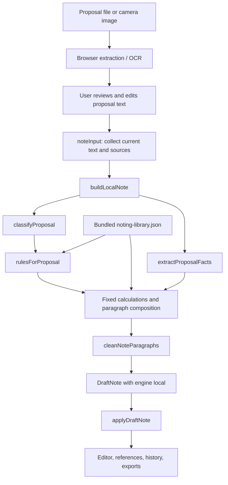

# How the Local, Non-AI Noting System Works

- **Project:** InstinctGo
- **Reviewed:** 7 November 2026
- **File:** `docs/offline-noting-system.md`
- **Absolute location:** `D:\instinctgo\docs\offline-noting-system.md`
- **Scope:** The current browser-side note generator, explained in ordinary language and technically.

## The short answer

**The local noting system is a rule-and-template-based document generator.**
It finds recognizable details in the reviewed proposal, selects a prepared note
format, checks the supplied rule library, performs the calculations already written
in code, and assembles those pieces into an editable note.

In ordinary words, it works like a clerk using a worksheet, a set of standard
paragraphs, a rule reference book, and a calculator.

Technically, its central operation is:

```text
Reviewed proposal text + supporting text + bundled rule/format library
    → pattern matching
    → structured facts and category
    → applicable rule selection
    → fixed calculations and paragraph assembly
    → structured DraftNote
    → formatted HTML, plain text, and browser case state
```

The function that actually creates the local note is **`buildLocalNote()`** in
[`frontend/src/lib/playground/note-draft.ts`](../frontend/src/lib/playground/note-draft.ts).
It does not call an LLM, need an API key, or send the proposal to a server.

## Contents

1. [The process in normal words](#1-the-process-in-normal-words)
2. [What offline means in the current application](#2-what-offline-means-in-the-current-application)
3. [System design and component responsibilities](#3-system-design-and-component-responsibilities)
4. [How a document becomes reviewed text](#4-how-a-document-becomes-reviewed-text)
5. [How the program identifies the request and its facts](#5-how-the-program-identifies-the-request-and-its-facts)
6. [Where the note-writing knowledge comes from](#6-where-the-note-writing-knowledge-comes-from)
7. [How rules and calculations are selected](#7-how-rules-and-calculations-are-selected)
8. [How the actual sentences are produced](#8-how-the-actual-sentences-are-produced)
9. [How the result becomes an editable note](#9-how-the-result-becomes-an-editable-note)
10. [Worked example from the current code](#10-worked-example-from-the-current-code)
11. [Why different proposals produce different notes](#11-why-different-proposals-produce-different-notes)
12. [What validation currently does](#12-what-validation-currently-does)
13. [Saving, exports, and the assistant](#13-saving-exports-and-the-assistant)
14. [Current implementation boundaries](#14-current-implementation-boundaries)
15. [How to inspect or extend the design](#15-how-to-inspect-or-extend-the-design)
16. [Source-code reading map](#16-source-code-reading-map)

## 1. The process in normal words

Imagine that an employee submits a GPF advance application.

### Step 1: Read the document

The browser converts the uploaded document into text. A normal PDF may already
contain selectable text. A photograph or scanned PDF needs OCR to read the letters.

### Step 2: Let the user correct that text

The application shows an editable transcription. The user can fix a name, an amount,
or a sentence that was read incorrectly. The note is prepared from this **reviewed
text**, including the user's corrections.

### Step 3: Decide what kind of application it is

The program looks for known words and phrases. For example, “GPF” and “advance”
can select the GPF advance category. “Duplicate payment” and “refund” can select
the fee-refund category.

### Step 4: Fill a small internal worksheet

It looks for details such as:

- Applicant name.
- Department or course.
- Reference number.
- Application date.
- Amount requested.
- GPF balance and repayment instalments.

It also remembers the text from which each recognized detail was extracted.

### Step 5: Select the writing format and relevant provisions

The project contains prepared note-writing profiles and a reviewed collection of
GPF and consultancy rules. The program selects a profile and filters the rules
using the request category, institutional context, and relevant keywords.

### Step 6: Do the calculations it knows

For a qualifying GPF advance request, it can compare the requested amount with
50% of the stated balance and calculate equal monthly instalments. These are
ordinary programmed calculations.

### Step 7: Assemble the note

It combines:

1. A routing heading and subject.
2. An applicant/amount table.
3. A standard introduction filled with the extracted details.
4. An extract of the applicant's own request.
5. A prepared examination paragraph.
6. Applicable calculation and rule-explanation paragraphs.

### Step 8: Open it for editing and review

The generated note appears in the editor. The original document and the proposal
text used to generate it remain separately available. The user can edit, save
session versions, preview, and download the note.

**Why this works without generative AI:** the program already contains the writing
patterns and supported examination logic. It fills and combines them with the
current proposal's particulars.

## 2. What offline means in the current application

### 2.1 Local drafting is independent of the backend

`buildLocalNote()` is a synchronous TypeScript function. Its input is text and its
output is an ordinary JavaScript object. It uses a JSON library imported into the
frontend bundle, regular expressions, string operations, and arithmetic.

| Dependency | Needed for local note generation? |
| --- | --- |
| Reviewed proposal text | Yes |
| Frontend JavaScript and bundled noting library | Yes |
| OpenAI or another LLM | No |
| API key | No |
| Python/FastAPI note processing | No |
| PostgreSQL, SQLite, Redis, or ARQ | No |
| Browser-accessible application assets | Yes, for the application and its other features |

### 2.2 The current button uses an automatic engine selector

The UI calls `requestNoteDraft()` in
[`note-service.ts`](../frontend/src/lib/playground/note-service.ts), which works as follows:

```text
1. Build the local note immediately.
2. Ask /api/v1/noting/capabilities whether AI is available.
3. If AI is unavailable, return the already-built local note.
4. If AI is available, request an AI draft.
5. If that request fails or its response fails the client's checks,
   return the already-built local note.
6. If the user explicitly cancels, abandon the operation.
```

The capability check has a 2.5-second client timeout. The optional AI draft request
has a 70-second client timeout. A failed capability request also returns the local
candidate, so a working backend is not required for the local path.

There is currently no dedicated **force local** switch in the workspace. If the
backend reports AI availability and the AI request succeeds, the UI uses that
result. The displayed **Local drafting** label identifies a selected local result.
The capability request itself carries no proposal body; the optional AI draft POST
does carry the reviewed proposal and supporting text.

### 2.3 Browser-local is different from an installed offline website

The repository does not implement a service worker or an offline application-shell
cache. The page, JavaScript chunks, PDF/OCR workers, export libraries, and rule PDFs
must be available from a running site/local server or the browser's existing cache.

Consequently:

- The drafting function can run with no network access once its code/data are loaded.
- A locally served installation can perform this work without internet access once
  its dependencies and assets have been prepared.
- Disconnecting a hosted site before an extractor/export chunk or source PDF loads
  can prevent that feature from loading.
- “Local drafting” does not promise that a fresh page load will work disconnected.

### 2.4 The OCR distinction

The **note-writing engine** is deterministic and has no trained model. Scanned-file
extraction uses Tesseract's locally executed English OCR model. Therefore the entire
scan-to-note pipeline can include machine-learning-based character recognition,
while note composition itself remains rule/template based. OCR reads text; it does
not decide the financial reasoning or write the examination note.

## 3. System design and component responsibilities

### 3.1 The main design



This diagram expands the local branch. The UI's engine selector may choose the
optional AI branch before passing its selected draft to `applyDraftNote()`.

### 3.2 Separation of responsibilities

| Responsibility | Owner | Normal-language explanation |
| --- | --- | --- |
| Session and button actions | `administrative-playground.tsx` | Coordinates what the user is doing |
| File-to-text conversion | `extract-document.ts`, `document-text.ts` | Reads the paperwork |
| Draft input assembly | `noteInput()` | Collects the current worksheet and attachments |
| Request classification | `classifyProposal()` | Chooses which kind of file this is |
| Fact extraction | `extractProposalFacts()` | Finds the particulars |
| Institution identification | `institutionOf()` | Finds whose rules may apply |
| Rule selection | `rulesForProposal()` | Chooses relevant provisions from the supplied library |
| Draft composition | `buildLocalNote()` | Fills prepared paragraphs and calculates supported amounts |
| Presentation cleanup | `cleanNoteParagraphs()` | Removes configured boilerplate sentences |
| Formatting and state transition | `applyDraftNote()` | Turns the structured draft into the working note |
| Human editing | `NoteEditor` | Lets the user revise the document |
| Review checks | `validateNote()`, `advanceWorkflow()` | Checks supported review conditions and file movement |

The drafting core is separate from the UI and network wrapper. It can be invoked
directly in tests or scripts with a `NoteInput`. The worked example below was checked
that way against the current functions.

### 3.3 Actual call chain when Convert to note is clicked

```text
AdministrativePlayground.convertToNote()
  → noteInput(item, state)
  → requestNoteDraft(input, cancellationSignal)
      → buildLocalNote(input)
          → clean / classifyProposal
          → select profile
          → extractProposalFacts / institutionOf
          → rulesForProposal
          → compose paragraphs and calculations
          → cleanNoteParagraphs
      → choose local candidate or optional AI result
  → applyDraftNote(item, state, selectedDraft, currentTime)
  → update React cases/states
  → render note stage
```

`buildLocalNote()` itself does not update React state, read a file, call a database,
or create a timestamp. These operations belong to surrounding components/functions.

## 4. How a document becomes reviewed text

**In normal words:** reading the document and writing the note are two separate steps.
The user explicitly asks for each one.

**Technically:** the intake system preserves an original Blob URL and creates a case.
The extraction path depends on the file type:

| File type | Local extraction mechanism |
| --- | --- |
| TXT/Markdown | UTF-8 decoding |
| DOCX | Mammoth raw-text extraction |
| Searchable PDF | PDF.js text extraction with line/paragraph reconstruction |
| Scanned PDF page | Render the page, then run English OCR |
| PNG/JPEG or camera capture | Canvas image preparation, then English OCR |

The principal limits are 20 MiB per primary file, 100 PDF pages, and 200,000 extracted
characters. A PDF page with usable embedded text follows the text path; OCR is the
fallback for pages without usable text, not an analysis of every image region.

`applyExtractedText()` creates escaped paragraph HTML and parallel plain text, then sets:

```text
draftKind = proposal
status = Extracted draft
stage = 6
version author = Browser extraction
```

The `stage` number marks review-ready text. It does not mean that six AI processing
stages have executed. Editing this text does not automatically generate or replace
a note; **Convert to note** is a separate action.

## 5. How the program identifies the request and its facts

### 5.1 Input data

The local function accepts the following TypeScript shape:

```ts
interface NoteInput {
  title: string;
  proposal_text: string;
  proposal_id: string;
  supporting_documents: {
    id: string;
    title: string;
    text: string;
  }[];
}
```

`noteInput()` takes `proposal_text` from **`state.text`**, the user's current edited
proposal. It takes supporting text from `state.extraDocuments` and the source ID from
the original document. The case title is capped at 240 characters.

The local drafter requires at least 20 characters after proposal cleanup. It rejects
combined cleaned proposal and supporting-text length above 200,000 characters.
The backend's additional strict schema limits are not automatically run on this
local-only path.

### 5.2 Text normalization

The core uses two helpers:

- `clean()`: Unicode NFKC normalization, normalized line endings, nonbreaking spaces
  converted to ordinary spaces, and edge trimming.
- `compact()`: the cleaned text with consecutive whitespace collapsed.

Normalization helps the same matching patterns work with text originating from a
PDF, Word file, or typed application. Label extraction retains line structure;
sentence extraction and selected free-form patterns use a flattened version.

### 5.3 Request classification

**In normal words:** the program chooses a branch by recognizing phrases.

**Technically:** `classifyProposal()` uses an ordered list of regular-expression
checks. It prefers a specific `Subject:`, `Sub:`, or `Re:` line. If the subject is
generic or absent, it examines the full reviewed text. A specific request takes
precedence over incidental cross-category mentions. No user-selected type or mode
is required, and filenames are not category signals.

| Check order | Result |
| --- | --- |
| Hiring/appointing an external consultant | `procurement` |
| Consultancy signal plus refund request | `service-refund` |
| Consultancy/client/DUCF and related topic signals | `consultancy` |
| GPF signal and final-payment/retirement request | `gpf-final` |
| GPF signal and withdrawal/non-refundable request | `gpf-withdrawal` |
| GPF signal and advance request | `gpf-advance` |
| Refund plus hostel topic | `hostel-refund` |
| Refund plus service/laboratory/analysis topic | `service-refund` |
| Refund plus duplicate/excess-payment topic | `fee-refund` |
| Refund plus admission/seat-withdrawal topic | `admission-refund` |
| Other refund wording | Usually `fee-refund`, with an additional hostel-text check |
| Leave/absence regularization topic | `leave` |
| Purchase/procurement/quotation/tender topic | `procurement` |
| No recognized branch | `general` |

GPF matching removes a few specific negated phrases, such as “not a non-refundable
withdrawal,” before choosing advance versus withdrawal. This is a targeted text rule,
not a general-purpose understanding of negation or legal intent.

### 5.4 Fact extraction

**In normal words:** it fills known boxes from recognizable labels and a few common
ways of writing an application.

**Technically:** `extractProposalFacts()` scans the main proposal first, followed by
supporting documents in their supplied order. Within each source it tries labelled
fields, then selected free-form patterns.

| Stored key | Example recognized labels |
| --- | --- |
| `applicant` | Applicant, Applicant name, Name, Student name, Employee name |
| `department` | Department, Dept., Course, Programme, Program, Centre |
| `reference` | Reference, Case reference, Employee ID, Student ID, Roll number, GPF account |
| `application_date` | Application date, Date |
| `amount_requested` | Advance requested, Amount requested, Refund requested, Amount claimed, Estimated cost/expenditure/value, Proposed expenditure, Procurement value |
| `fund_balance` | GPF balance, Fund balance |
| `instalments` | Repayment instalments/installments, Instalments/Installments |
| `monthly_pay` | Monthly pay, Monthly salary, Basic pay |
| `consultancy_earnings` | Distributable consultancy earnings, Distributable earnings |
| `consultancy_days` | Consultancy leave days requested |
| `yearly_consultancy_days` | Consultancy leave already taken this calendar year |
| `annual_consultancy_fees` | Total yearly consultancy fees, Annual consultancy fees |
| `annual_salary` | Gross annual University salary, Gross annual salary |

There is also `amount_mentioned`, used for a narrowly defined amount fallback.
Estimated-cost/expenditure labels are treated as a requested amount for procurement
only, so an incidental estimate does not replace the amount of a refund request.

Free-form extraction recognizes selected patterns such as “My name is…,” a name
after “Yours faithfully,” “Department of…,” a reference containing digits, a requested
currency amount, and “36 equal monthly instalments.”

Important implementation details:

- **The first accepted value for a key wins.** A later supporting source does not
  overwrite an already extracted proposal fact.
- A value must be nonempty and no longer than 240 characters.
- Evidence is recorded with the value and capped at 1,200 characters.
- A labelled monetary field is accepted only when it contains one recognized
  currency token.
- Free-form requested-amount matching checks for one distinct matched monetary value.
- If no requested amount is found, a single distinct amount in the main proposal can
  become `amount_mentioned`, provided a fund-balance fact was not already extracted.

Example fact:

```json
{
  "key": "amount_requested",
  "value": "INR 180000",
  "evidence": "Advance requested: INR 180000",
  "source_id": "case-001-original"
}
```

The value/evidence come from matched, normalized source text. This records where a
detail came from; it does not independently confirm the applicant's account balance.

### 5.5 Money and institution parsing

`moneyValue()` recognizes currency markers `INR`, `Rs.`, and `₹`, digit separators,
decimal amounts, and units such as thousand, lakh/lac, and crore. It converts the
matched value to a JavaScript number. Generated calculations are formatted using
Indian digit grouping, for example `Rs. 1,80,000/-`.

`institutionOf()` tries:

1. An `Employer:`, `Employing institution:`, or `University:` line.
2. A university-name heading among the first 15 lines.
3. An occurrence of “Dibrugarh University.”

It returns `null` if none matches. A generic `Institution:` field is not one of
its employer-label matches; that field could, for example, name a dependent child's
college rather than the applicant's employer.

## 6. Where the note-writing knowledge comes from

### 6.1 Two sources of programmed knowledge

**The local system works because domain knowledge has already been encoded in both
data and code.**

| Location | What is encoded there |
| --- | --- |
| `samples/noting-library.json` | Category profiles, office routing text, examination paragraphs, rulebook metadata, excerpts, applicability terms, source pages, removable boilerplate prefixes |
| `note-draft.ts` | Classification order, extraction patterns, missing-field checks, arithmetic conditions, generated sentences, table-field selection |

The library is imported as JSON into the frontend build. It is available to the
local drafter without a database query. It currently has eight profiles,
eleven request categories, four rulebooks, and 61 reviewed rule entries.

### 6.2 Writing profiles

| Profile | Used for | Example of its contribution |
| --- | --- | --- |
| Fee refund | Duplicate/excess fee refund | Payment/receipt/ledger reconciliation wording |
| Admission refund | Admission withdrawal/refund | Dates, refund provisions, deductions |
| Hostel refund | Hostel refund | Allotment, vacation/clearance, dues |
| Service refund | Unprovided service/analysis-fee refund | Requisition, payment, actual service status |
| GPF | Advance, withdrawal, final payment | Subscriber, purpose, balance, recovery examination |
| Consultancy | University consultancy | Client, scope, period, facilities, financial terms |
| Procurement | Procurement, purchases, outside-consultant engagement | Requirements, specifications/quantity, expenditure, funding, quotations/bids, financial authority |
| General | General, leave | Broad factual/financial examination wording |

An exact GPF profile excerpt is:

```json
{
  "id": "gpf",
  "categories": ["gpf-advance", "gpf-withdrawal", "gpf-final"],
  "title": "GPF examination in the supplied administrative-note format",
  "pages": [6, 7],
  "routing": "Registrar / Finance & Accounts / Internal Audit / Concerned Section",
  "examination": "The GPF examination concerns the type of request, subscriber particulars, purpose, fund balance and recovery terms."
}
```

### 6.3 How the sample notes influence output

The source sample-note PDF supplied the reviewed writing/layout guidance encoded in
the JSON and formatting code. **The local generator does not reopen sample PDFs and
learn their style each time a proposal is uploaded.** It uses the already prepared
profiles, sentences, and rendering logic.

The library's `styleGuide` contains human-readable guidance, but the local function
does not interpret those sentences as executable instructions. Its behavior comes
from the fields it explicitly reads and the TypeScript implementation.

Similarly, uploading a new document containing rules makes it supporting text; it
does not automatically register an approved rulebook, new formula, or note template.

## 7. How rules and calculations are selected

### 7.1 Rule selection

**In normal words:** it checks whether a provision belongs to this kind of request
and this institution before attaching it to the note.

`rulesForProposal()` keeps a rule only when all applicable conditions pass:

```text
The rule includes this request category
AND the proposal matches the rulebook's subject signal
AND the institution/jurisdiction/adopted-framework conditions match the rulebook
AND, if requiresAny exists, at least one listed relevance term occurs
AND, if requiresPattern exists, its token/phrase expression matches
```

This is filtering an in-memory array of reviewed entries. There is no embeddings
database, semantic search service, or model ranking step.

Currently registered rulebooks are:

- Dibrugarh University General Provident Fund Rules, 2013.
- Consultancy Service Rules of Dibrugarh University.
- Assam Public Procurement Rules, 2020 (104-page supplied scan).
- Government of India Manual for Procurement of Works, 2019 (187 pages).

GPF/consultancy rules retain their existing institutional checks. The procurement
books require an Assam or central/adopted-framework context through `scopePattern`
or `scopeInstitutions`, and the central works manual also requires a works subject.
An Assam vendor address alone does not establish Assam jurisdiction. Scope and
amendment confirmations are recorded separately. If no rule is selected, the note
can still be generated with missing-policy information in metadata.

The two manuals add 35 reviewed provisions and source page links. The local writer
can quote their stated policy thresholds in rule-examination paragraphs. These are
source conditions, not newly executed procurement or approval decisions. The full
PDFs remain available for reference beyond the curated summaries. See
[procurement source integration](../samples/procurement-sources.md).

### 7.2 Calculations are explicitly programmed

The program does not read an arbitrary PDF clause and turn it into arithmetic.
These computations are written in `buildLocalNote()`:

| Case | Inputs | Calculation/check |
| --- | --- | --- |
| GPF advance | Requested amount, fund balance | Ceiling = `Math.floor(balance * 50) / 100`; compare request with ceiling |
| GPF repayment | Requested amount, instalment count | Count must be a positive integer for this branch; flag above 36; output an equal instalment amount only when the principal divides evenly |
| GPF withdrawal | Fund balance, monthly pay | Lower of `Math.floor(balance * 75) / 100` and `pay * 20`; compare request when known |
| Consultancy distribution | Stated distributable earnings | 60% group, 40% University; within group, 60:40 produces 36%/24% of original total |
| Consultancy leave | Requested days, days already used | Flag above 5 per spell or above ordinary 20 days per calendar year |
| Consultancy annual fees | Annual fees, annual University salary | For relevant categories, flag fees exceeding salary |

The GPF formulas compute 50%/75% while flooring to paise. Consultancy share formulas
round to paise. These use JavaScript `Number` arithmetic rather than a decimal-money
library. Their branches also require selected category rules, and some consultancy
checks require the specific applicable rule ID.

**The difference between a selected rule and an executed check matters.** For example,
the note can reference subscriber eligibility or previous-advance conditions while
the general local engine does not extract and verify every service-history detail.
The code calculates only the cases explicitly implemented above.

### 7.3 Findings versus note prose

Over-limit amounts can produce an entry such as:

```json
{
  "kind": "error",
  "title": "GPF advance exceeds the supplied limit",
  "detail": "Obtain a revised request within the verified 50% ceiling before an approval is recorded."
}
```

The examination note still gets generated. Missing particulars are collected in
`missing_information`; findings are collected in `findings`. During application to
the case, missing items also become warning findings.

The program does not automatically calculate an interest rate, a current tax rate,
or a student-refund percentage from these sources. Consultancy tax-date and refund
authority questions are recorded as missing information when relevant.

## 8. How the actual sentences are produced

### 8.1 The note is assembled from several kinds of content

| Visible content | How it is produced |
| --- | --- |
| Routing heading | Copied from selected profile's `routing` |
| Subject | Extracted subject, category default, or suitable general-case input title |
| Applicant table | Values inserted into a fixed four-column structure |
| Receipt paragraph | Fixed sentence with optional date/name/reference substitutions |
| Applicant's circumstances | Selected extract from the proposal itself |
| Examination paragraph | Profile's prepared `examination` text |
| GPF calculation paragraph | Fixed sentence with calculated values and within/exceeds branch |
| GPF rule summary | Category-specific text written in TypeScript |
| Rule application paragraphs | Selected rule `application` strings, grouped in batches of three through the shared drafter |
| Missing fields/conflicts | Structured metadata, rather than an automatic closing list |

### 8.2 Subject and introduction

`subjectOf()` recognizes the labelled subject, removes a leading “request for,” and
caps it at 240 characters. `buildLocalNote()` capitalizes the first character.
Without a subject, it uses a category title. For a `general` request it can use the
input title if that title is not merely something generic like “proposal” or “scan.”

The opening uses this pattern:

```text
An application [dated DATE] [from APPLICANT] has been received concerning SUBJECT.
The uploaded proposal [(reference / identification: REFERENCE)] may kindly be seen
in the file.
```

Square brackets here indicate optional substitutions, not literal generated text.
This fixed wording is why different local notes can share a similar opening.

### 8.3 Selecting the applicant's own wording

The local drafter:

1. Collapses the proposal's whitespace.
2. Looks for a likely body beginning such as “I,” “We,” “Please,” or “Kindly.”
3. Uses `Intl.Segmenter("en", { granularity: "sentence" })` to separate sentences.
4. Keeps sentences at least 25 characters long containing request-related terms
   such as request, refund, payment, advance, withdrawal, leave, or consultancy.
5. Selects up to the first three matching sentences, joining them with an ellipsis.
6. Falls back to cleaned proposal prose when there are no matching sentences.
7. Caps the selected statement at 1,600 characters.

It wraps that statement in:

```text
The applicant's stated request and circumstances are recorded in the following
extract: “SELECTED TEXT”
```

This is a bounded extract, not an abstractive model-generated summary. A key fact
outside the selected extract may still be available in the preserved proposal or
recognized fact table; the quote does not reproduce the entire application.

### 8.4 Cleanup and closing behavior

`cleanNoteParagraphs()` splits blocks and sentences, normalizes comparison text,
and removes items starting with prefixes listed in `notePresentation.omitPrefixes`.
Examples include standard clarification endings, “If the particulars are verified,”
“Put up for your kind perusal,” and disclaimer prefixes.

Both local draft generation and note application run this cleaner. Export also runs
note-specific cleanup. The stored original/reviewed proposal is not rewritten by
this process, although proposal extracts included in generated prose pass through
the cleaner.

The local result sets `recommendation: ""`. It does not append an automatic final
recommendation or standard closing. The current note consists of its headings,
particulars, and substantive examination paragraphs.

## 9. How the result becomes an editable note

### 9.1 The intermediate output

`buildLocalNote()` returns a `DraftNote`, containing:

```text
subject, category, institution, routing
facts[]                         recognized values with evidence/source IDs
paragraphs[]                    generated substantive text
recommendation                  currently empty for local output
applied_rules[]                  IDs and reasons
missing_information[]           unrecognized/required context
findings[]                      warning/error objects
engine = local                  visible engine identity
style_sources[]                 format-reference path and pages
```

Separating this structured object from HTML allows the same renderer/state transition
to accept either a local candidate or an optional server-generated candidate.

### 9.2 Converting the object into the working document

`applyDraftNote()` first checks that:

- The current draft is proposal text.
- Extraction/review-ready stage has been reached (`stage >= 6`).
- Review movements have not already occurred.
- The category has a profile and substantive paragraphs.
- Applied rule IDs are eligible for this reviewed text and institution.

It then creates:

1. Bold, underlined routing and subject headings.
2. A four-column table: **Sl. No. / Applicant–Reference / Department–Request / Amount**.
3. Escaped paragraph HTML, with line breaks preserved.
4. A plain-text equivalent.

The table amount preference is requested amount, then consultancy earnings, then
amount mentioned. Unknown particulars become an em dash rather than a fabricated
name or amount. Escaping ensures that source text is inserted as document text
rather than executable HTML.

### 9.3 State changes

The function returns new case/state objects with:

- `caseTemplateId = "example-based-noting"`.
- `draftKind = "note"` and `status = "Generated note"`.
- Review level reset to 0 and verification checks cleared.
- The exact reviewed proposal saved in `proposalDraft`.
- New versions for **Proposal text used for noting** and **Note from uploaded proposal**.
- Applied rule IDs, engine identity, format-source metadata, and missing information.
- Original source plus the applied rule source records; extra supporting records
  remain in state.

The temporary `DraftNote.facts` contains the detailed evidence/source association.
The resulting `CaseDefinition.facts` stores display labels and values, not a separate
durable per-fact evidence table. Original/supporting text and rule references remain
available, but there is no persistent fact-provenance database.

GPF advance/withdrawal authority rules can set the terminal role to Vice-Chancellor.
Otherwise the imported case's default terminal, Registrar, is retained. The routing
heading is writing content; it is not automatically parsed into a committee workflow.

## 10. Worked example from the current code

This example and the variations below were run directly through the current local
functions while preparing this document. The applicant is fictional.

### 10.1 Reviewed proposal input

```text
University: Dibrugarh University
Subject: Request for a refundable GPF advance
Applicant: Ananya Das
Application date: 2026-11-07
Department: Department of Physics
Reference: GPF-2026-001
GPF balance: INR 600000
Advance requested: INR 180000
Repayment instalments: 36

I request a refundable GPF advance for the higher education of my dependent child.
```

### 10.2 The program's decisions

| Item | Result |
| --- | --- |
| Category | `gpf-advance` |
| Institution | `Dibrugarh University` |
| Profile | `gpf` |
| Generated subject | `A refundable GPF advance` |
| Applicant/reference | `Ananya Das` / `GPF-2026-001` |
| Requested amount | `INR 180000` |
| Fund balance | `INR 600000` |
| Count | `36` |
| Ceiling | `600000 × 50% = 300000` |
| Instalment | `180000 ÷ 36 = 5000` |
| Applied entries | Seven GPF entries covering Rules 5 and 12.1–12.1.6 |
| Engine | `local` |
| Format-source pages | 6 and 7 |
| Resulting terminal | Vice-Chancellor |

The leading “A” in the subject is the actual current output: the subject cleaner
removes “Request for” and then capitalizes what remains. There is no additional
grammar-rewriting stage.

### 10.3 What appears in the note

Routing:

> Registrar / Finance & Accounts / Internal Audit / Concerned Section

Subject:

> A refundable GPF advance

Particulars table, represented here in Markdown:

| Sl. No. | Applicant / Reference | Department / Request | Amount stated |
| --- | --- | --- | --- |
| 1 | Ananya Das; GPF-2026-001 | Department of Physics | INR 180000 |

The actual generated paragraphs are:

> An application dated 2026-11-07 from Ananya Das has been received concerning A refundable GPF advance. The uploaded proposal (reference / identification: GPF-2026-001) may kindly be seen in the file.

> The applicant's stated request and circumstances are recorded in the following extract: “I request a refundable GPF advance for the higher education of my dependent child.”

> The GPF examination concerns the type of request, subscriber particulars, purpose, fund balance and recovery terms.

> The stated GPF balance is Rs. 6,00,000/-, giving a 50% ceiling of Rs. 3,00,000/- under Rule 12.1.2. The requested Rs. 1,80,000/- is within that stated ceiling.

> The stated 36-month principal schedule corresponds to 36 equal instalments of Rs. 5,000/- under Rule 12.1.4.

> Rule 5 sets out subscriber eligibility. Rules 12.1.1–12.1.3 cover the permitted purpose and previous advances; Rules 12.1.4–12.1.6 govern recovery and interest.

### 10.4 Where each part came from

| Part | Source of the wording/value |
| --- | --- |
| Routing | GPF JSON profile |
| Subject | Reviewed proposal subject and string cleanup |
| Table | Regex-extracted facts |
| Paragraph 1 | Fixed introduction with substitutions |
| Paragraph 2 | Extracted proposal sentence wrapped in fixed wording |
| Paragraph 3 | Profile's `examination` text |
| Paragraph 4 | Hard-coded sentence plus balance/request arithmetic |
| Paragraph 5 | Hard-coded sentence plus equal-instalment arithmetic |
| Paragraph 6 | Hard-coded GPF rule summary |

This table explains the core mechanism: every visible part has a predictable source.

## 11. Why different proposals produce different notes

Different inputs change the recognized category, extracted values, selected profile,
rule matches, quoted request, calculations, and conditional sentences.

### 11.1 Verified variations of the example

| Change | Current local result |
| --- | --- |
| Change institution to `Example University` | Still classified GPF advance, but no Dibrugarh rules or rule-dependent GPF calculation paragraphs; missing institutional-policy information is recorded |
| Request `INR 400000` against the same balance | Note says the request exceeds the Rs. 3,00,000 ceiling and records an error finding |
| Request `INR 180001` with 36 instalments | Within-ceiling paragraph remains; equal-instalment paragraph is omitted because it does not divide evenly; the current general local function adds no dedicated divisibility error |
| Submit a duplicate semester-fee refund | Uses fee-refund profile and request facts; no GPF/consultancy rule is selected solely because the applicant is at Dibrugarh University |

These examples show both supported branching and its present limits. A rule mentioned
in the note may contain conditions that the code does not fully evaluate.

### 11.2 Consultancy example of programmed reasoning

When the request matches consultancy earnings distribution and explicitly supplies
distributable earnings of INR 100000, the relevant formula produces:

```text
Consultants/staff group: 100000 × 60% = 60000
University:             100000 × 40% = 40000
Within the group:
  Consultants:           60000 × 60% = 36000
  Eligible staff:        60000 × 40% = 24000
```

The nested distribution is encoded in TypeScript and enabled by the selected
consultancy rule. A generic amount on an unrelated document does not trigger it.

### 11.3 Predictability

With the same normalized input, bundled library, code, and JavaScript runtime behavior,
the local generator follows the same branches and produces the same draft. There
is no model temperature, sampled response, or learning from past submissions.
Timestamps and case IDs are added by surrounding session code, not by the draft writer.

## 12. What validation currently does

### 12.1 During local drafting

The local function checks its basic input length, extracts only recognized fields,
filters rule applicability, and records its implemented financial findings. It can
generate an examination note even when some particulars or institutional policies
are missing.

It does **not** invoke the Python AI-response validator on a local draft. The
`factIsGrounded()` check in `note-service.ts` is used for an incoming AI response;
the already-built local candidate is returned directly on the local path.

### 12.2 During note application

`applyDraftNote()` checks the proposal stage, profile, substantive paragraphs, and
applied rule IDs before changing the document into a note. These are state/structure/
applicability checks rather than an external review of applicant records.

### 12.3 During later review

`validateNote()` checks error findings, linked/applied source IDs, source-status
metadata, and monetary edits against amounts represented in the generated case note.
Human editing adds a verification warning. The sequential workflow requires the
assigned simulated role and the configured review confirmations for relevant actions.

Approval is blocked when `validateNote()` reports an error. A generated note with
missing policy can still be edited/exported even if the review flow later blocks a
decision for missing/current-source evidence. Note generation and approval are
separate operations.

## 13. Saving, exports, and the assistant

### 13.1 What Save means

The application holds originals, reviewed text, notes, versions, findings, and review
activity in React state. Editing updates the current session draft; **Save note**
adds a snapshot. Reloading clears this state.

The separate backend `workflows` database stores generic workflow plans, not these
finance notes. The local generator does not call a note-save API or store cases in
browser `localStorage`/an application IndexedDB database.

### 13.2 Preview and downloads

- Tiptap provides the editable HTML document and plain-text representation.
- The preview paginates the current HTML in the browser.
- TXT downloads use current text.
- Word output uses the browser `docx` package.
- PDF output uses jsPDF and the project's document drawing helper.

The export code uses the edited note, including its table. It preserves selected
paragraph-level emphasis, not every rich-text mark or editor font-size choice.
Exports do not ask an LLM to rewrite the note or call a server export service.

### 13.3 Why the assistant also works without an AI provider

The panel labelled **AI Assistant** currently uses the deterministic `demoAI` adapter
in `assistant.ts`. It matches question patterns, quotes current text, extracts known
particulars, and searches supplied rules by rule number or keywords.

Before conversion it directs the user to **Convert to note**. After conversion it can
explain stored facts/rules or suggest existing note wording. It does not perform a
second local reasoning-model call, automatically create the note through chat, or
carry out approval/signing actions.

## 14. Current implementation boundaries

These details are important when interpreting what a generated local note means:

| Area | Current behavior |
| --- | --- |
| Language understanding | Known English patterns and keywords; unrecognized wording can be missed or classified generally |
| Multiple applicants/transactions | One main particulars row and one stored value per fact key, not a general multi-entity extraction system |
| Conflicting source values | First accepted fact wins; there is no general conflict-resolution algorithm |
| Dates and identity | Recognized text is copied; the general local path does not independently validate every date or identity |
| Rule interpretation | Reviewed metadata selects rules; only explicitly programmed checks become executable calculations |
| Procurement requests | Automatically select the procurement profile and scope-matched provisions from the registered Assam/central manuals, with source edition and page links |
| General/leave requests | Can receive profile-based notes without the detailed category-specific calculations available for GPF/consultancy |
| Unmatched policy | Note can still be formed, with missing-policy metadata |
| Missing instalments or non-divisible schedule | Equal-instalment prose may be absent without a dedicated local error finding |
| Financial completeness | An empty findings array does not mean every possible rule condition has been evaluated |
| Source authority | Library `Current` status is configured metadata; no live policy-update or institutional ledger lookup occurs |
| Knowledge updates | Require editing/rebuilding the relevant JSON/code; uploads do not retrain the generator |
| Session durability | Browser session memory, with user downloads for file retention |
| Offline loading | Assets must be available; there is no installed offline-shell guarantee |

### The older GPF sample parser

`gpf-case.ts` also contains `parseGpfProposal()` and `convertGpfProposal()`. That older
fixed-case path requires the sample ID and specific fields, and performs stricter
sample-specific checks such as previous-advance and repayment reconciliation.

The current **Convert to note** button uses `requestNoteDraft()` → `buildLocalNote()`
for its local candidate. The fixed GPF helpers remain useful for sample preparation
and tests, but their stricter checks should not be assumed to run for every newly
uploaded proposal. The sample button itself uses the ordinary file/extraction flow.

## 15. How to inspect or extend the design

### 15.1 Inspect a local draft directly

The essential invocation is:

```ts
import { buildLocalNote } from "./frontend/src/lib/playground/note-draft";

const draft = buildLocalNote({
  title: "Refund request",
  proposal_id: "example-original",
  proposal_text:
    "Subject: Refund of duplicate fee\n" +
    "Applicant: Example Applicant\n" +
    "Amount requested: INR 10000\n" +
    "I paid the fee twice and request a refund of the duplicate payment.",
  supporting_documents: [],
});

console.log(draft.category);
console.log(draft.facts);
console.log(draft.paragraphs);
console.log(draft.applied_rules);
console.log(draft.missing_information);
```

This example assumes a TypeScript-capable runner from the repository root with the
project dependencies installed. It exercises the draft-writing function directly,
independently of the UI's automatic engine selection.

Existing local logic tests can be run from the root:

```powershell
npm run test:playground --workspace @instinctgo/frontend
```

For the regular UI, a backend with `OPENAI_API_KEY` unset reports AI unavailable and
uses the local candidate. The frontend also falls back locally if the capability
endpoint is unreachable. No provider setting is changed by this document.

### 15.2 Change the system at the right layer

| Desired change | Where the implementation belongs |
| --- | --- |
| Recognize a new wording for an existing fact | Label/free-form extraction patterns in `extractProposalFacts()` |
| Improve request classification | Ordered matching logic in `classifyProposal()` |
| Change an existing profile's examination wording | `profiles[].examination` in the JSON library |
| Change generated opening or calculation sentences | `buildLocalNote()` |
| Change boilerplate cleanup | `notePresentation.omitPrefixes` and `cleanNoteParagraphs()` |
| Add a provision from an existing rulebook | Reviewed JSON rule entry, categories/relevance/page locator |
| Add a new rulebook | Source PDF, reviewed library metadata/rules, rulebook-resolution code and preparation support |
| Add a new executable financial check | Explicit TypeScript calculation/condition and meaningful verification cases |
| Add another field to the note | Fact types, extraction, presentation labels/table/paragraph use |
| Change note appearance | `applyDraftNote()`, editor/preview styles, export block handling |

Adding a PDF alone does not add executable reasoning. A new category or rulebook
requires aligning the classification, profiles, selection logic, and any formulas.
`rulebookFor()` resolves registered rulebook IDs through a shared lookup (legacy
entries without an ID default to GPF). New rule application wording uses the same
composition path. New executable calculations still require explicit implementation.

Procurement reference PDFs belong alongside the other rule originals in
`D:\instinctgo\samples\case-01\rules\`. Their source-file directory does not select
a proposal mode; the application selects the category and format from reviewed text.

## 16. Source-code reading map

All paths below are relative to `D:\instinctgo`.

| Read order | File | What to look for |
| --- | --- | --- |
| 1 | [`frontend/src/lib/playground/note-draft.ts`](../frontend/src/lib/playground/note-draft.ts) | Core input/output types, classifier, fact extractor, rule filter, local writer, state application |
| 2 | [`samples/noting-library.json`](../samples/noting-library.json) | Profiles, rulebooks, excerpts, relevance terms, cleanup prefixes |
| 3 | [`frontend/src/lib/playground/note-service.ts`](../frontend/src/lib/playground/note-service.ts) | Build local first, capability probe, optional AI request, fallback |
| 4 | [`frontend/src/lib/playground/note-content.ts`](../frontend/src/lib/playground/note-content.ts) | Generated-prose cleanup |
| 5 | [`frontend/src/components/playground/administrative-playground.tsx`](../frontend/src/components/playground/administrative-playground.tsx) | Conversion button, current text input, asynchronous coordination, session saves |
| 6 | [`frontend/src/lib/playground/extract-document.ts`](../frontend/src/lib/playground/extract-document.ts) | Browser file/OCR extraction |
| 7 | [`frontend/src/lib/playground/document-text.ts`](../frontend/src/lib/playground/document-text.ts) | Text normalization and proposal-stage creation |
| 8 | [`frontend/src/components/playground/studio.tsx`](../frontend/src/components/playground/studio.tsx) | Note-stage rule library and editor/assistant layout |
| 9 | [`frontend/src/components/playground/note-editor.tsx`](../frontend/src/components/playground/note-editor.tsx) | Rich-text editing and manual citations |
| 10 | [`frontend/src/lib/playground/workflow.ts`](../frontend/src/lib/playground/workflow.ts) | Later review validation and state guards |
| 11 | [`frontend/src/lib/playground/renderer.ts`](../frontend/src/lib/playground/renderer.ts) | Escaping and current-draft export |
| 12 | [`frontend/src/lib/playground/assistant.ts`](../frontend/src/lib/playground/assistant.ts) | Deterministic assistant behavior |
| 13 | [`frontend/tests/playground.test.ts`](../frontend/tests/playground.test.ts) | Examples of actual supported cases and boundary behavior |

For the entire application's backend, APIs, deployment, and storage architecture,
see [Full System Architecture](architecture.md).

## Final summary

**In normal words:** the system reads the reviewed proposal, fills a known worksheet,
chooses a standard writing format, consults its supplied rule list, does its programmed
calculations, and joins those results into a note.

**Technically:** it is a browser-side deterministic text-processing and document-
composition pipeline: regular-expression classification/extraction + bundled JSON
profiles and rule filters + explicit arithmetic + string templates + HTML/state
rendering. That design is what currently makes local notes possible without a
generative AI provider.
